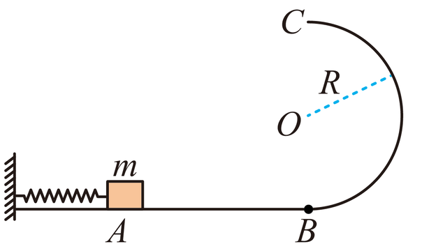

# Physics - 题目 2204

**ID**: f49922ee327a4a1da383d3ae471ecfaf
**年级**: Grade 12
**难度**: Medium-Hard
**题型**: Multiple-select

## 题目
如图所示，光滑水平面 $AB$ 与竖直面内的光滑半圆形轨道在 $B$ 点平滑相接，轨道半径为 $R$ 。​​​​​​​‌一个质量为 $m$ 的物体将弹簧压缩至 $A$ 点后由静止释放，在弹力作用下物体获得某一向右速度后脱离弹簧，它经过 $B$ 点之后沿半圆形轨道运动，重力加速度为 $g$ 。下列说法正确的是（      ）

## 解答

1. 物体在半圆形轨道上“始终不脱离轨道"有两种情况：
2. 1、能到达最高点C，临界条件是重力提供向心力，即 $mg=\frac {mv{{}_{c}}{^{2}}}{R}$ ，得 $v{{}_{{\rm{c}}}}=\sqrt {gR}$ ，从A到C，弹性势能全部转化为C点的动能和重力势能，即 $E{{}_{{\rm{p}}}}=\frac {1}{2}mv{{}_{C}^{2}}+mg\cdot 2R=\frac {1}{2}mgR+2mgR=\frac {5}{2}mgR$ 。
3. 2、物体在半圆轨道下半部分运动，不超过圆心高度。此时弹性势能只需满 $E{{}_{p}}\mathrm{⩽}mgR$ 。因此，“始终不脱离轨道”的条件是 $E{{}_{{\rm{p}}}}⩾\frac {5}{2}mgR$ 或 $E{{}_{{\rm{p}}}}⩽mgR{\rm ，A}$ 错误；物体从C点做平抛运动，竖直方向自由下落高度2R，其中C点速度为 $v{{}_{c}}$ ，竖直方向 $2R=\frac {1}{2}gt{^{2}}$ ，水平方向 $x=v{{}_{c}}t{\rm ，B}$ 到C的过程中机械能守恒 $\frac {1}{2}mv{{}_{B}^{2}}=\frac {1}{2}mv{{}_{C}^{2}}+mg\cdot 2R$ ，由以上各式可得 $x=\sqrt {v{{}_{B}^{2}}-4gR}\cdot 2\sqrt {\frac {R}{g}}=2\sqrt {\frac {v{{}_{B}}{^{2}}R}{g}-4R{^{2}}}$ ，当 $R=\frac {v{{}_{B}^{2}}}{8g}$ 时，水平位移有最大值 $x{{}_{{\rm \max }}}=4R$ ，所以B正确；物体在轨道上脱离时，轨道弹力N=0，重力沿半径的分力提供向心力，即 $mg{\cos}θ=\frac {mv{^{2}}}{R}$ （ $θ$ 为物体脱离位置与圆心O连线和竖直向上方向的夹角)。从B到脱离点机械能守恒，设脱离点的高度为 ${\rm \mathit{h}，}\frac {1}{2}mv{{}_{B}^{2}}=\frac {1}{2}mv{^{2}}+mgh$ ， $h=R+R{\cos}θ$ ， $v{{}_{B}}=\sqrt {3gR}$ ，联立可得 ${\cos}θ=\frac {1}{3}$ ， $h=R+R\cos θ=R+\frac {R}{3}=\frac {4}{3}R{\rm ，C}$ 正确；物体“恰好能到C点”，说明过C点时重力提供向心力 $mg=\frac {mv{{}_{c}}{^{2}}}{R}$ ，从B到C，由动能定理 $-mg\cdot 2R-W{{}_{f}}=\frac {1}{2}mv{{}_{C}^{2}}-\frac {1}{2}mv{{}_{B}^{2}}$ ，代入 $v{{}_{B}}=\sqrt {6gR}$ 可得 $W{{}_{f}}=\frac {1}{2}mgR{\rm ，D}$ 错误。

## 知识点

**中文**:
  - 应用动能定理求解变力做功问题
  - 弹簧问题中机械能守恒定律的应用

**English**:
  - Solving Work Done by Variable Force
  - Spring Problems

---
