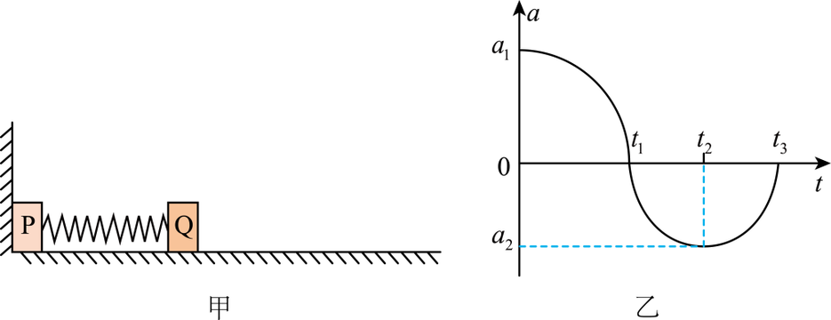

# Physics - 题目 2349

**ID**: f6998467ffaa4b8f93fa3056d3d076a0
**年级**: Grade 12
**难度**: Medium-Hard
**题型**: Multiple-select

## 题目
如图甲所示，质量均为m的物块P与物块Q之间拴接一轻质弹簧，静止在光滑的水平地面上，物块P与竖直墙面接触，初始时弹簧处于压缩状态并被锁定，弹簧的弹性势能大小为 $E{{}_{{\rm{P}}}}$ 。​​​​​​​‌某一时刻解除锁定，并把此时记为 $t=0$ 时刻，规定向右为正方向，（ $0\sim t{{}_{3}}$ 时间内物块Q运动的 $a-t$ 图像如图乙所示。下列判断正确的是（      ）

## 解答

1. 在 $0\sim t{{}_{3}}$ 时间内，物块P、Q以及弹簧组成的系统只有弹簧弹力做功，则该系统机械能守恒，A正确；弹簧恢复原长过程，物块P一直不动，此过程物块P、Q以及弹簧组成的系统受到墙壁的弹力作用，则该系统此过程所受的合外力不为0，其动量不守恒，此后物块P离开墙壁，物块P、Q以及弹簧组成的系统所受的合外力为0，其动量守恒，可见在 $0\sim t{{}_{3}}$ 时间内，物块P、Q以及弹簧组成的系统最初动量不守恒，最后动量守恒，B错误；由图知， $t{{}_{1}}$ 时刻物块Q的加速度为0，此时弹恰好恢复原长，物块P刚要运动， $t{{}_{2}}$ 时刻物块Q运动的加速度最大，且为负值，此时弹簧被拉得最长，物块P、Q的速度相同。弹簧恢复原长过程，由机械能守恒定律 $E{{}_{{\rm{P}}}}=\frac {1}{2}mv{{}_{0}^{2}}$ ，解得 $t{{}_{1}}$ 时刻物块Q的速度大小 $v{{}_{0}}=\sqrt {\frac {2E{{}_{{\rm{p}}}}}{m}}$ ，在 $t{{}_{1}}\sim t{{}_{2}}$ 时间内，对物块P、Q以及弹簧组成的系统，由动量守恒定律 $mv{{}_{0}}=2mv$ ，解得 $t{{}_{2}}$ 时刻物块P和Q的速度大小均为 $v=\sqrt {\frac {E{{}_{{\rm{p}}}}}{2m}}$ ，由动能定理知， $0\sim t{{}_{2}}$ 内合外力对物体Q做功 $W=\frac {1}{2}mv{^{2}}-0=\frac {E{{}_{{\rm{P}}}}}{4}{\rm ，C}$ 正确；由图知， $t{{}_{3}}$ 时刻物块Q的加速度为0，此时弹恰好恢复原长，在 $t{{}_{1}}\sim t{{}_{3}}$ 时间内，对物块P、Q以及弹簧组成的系统，由动量守恒定律 $mv{{}_{0}}=mv{{}_{{\rm{P}}}}+m{~}v{{}_{{\rm{Q}}}}$ ，由机械能守恒定律 $\frac {1}{2}mv{{}_{0}}{^{2}}=\frac {1}{2}mv{{}_{{\rm{P}}}}{^{2}}+\frac {1}{2}mv{{}_{{\rm{Q}}}}{^{2}}$ ，联立知， $t{{}_{3}}$ 时刻物块Q的速度 $v{{}_{{\rm{Q}}}}=0$ ，则 $t{{}_{1}}\sim t{{}_{3}}$ 内物块Q速度变化量 $\Delta v=0-v{{}_{0}}=-\sqrt {\frac {2E{{}_{{\rm{p}}}}}{m}}{\rm ，\mathit{a-t}}$ 图像中图线与t轴所围的面积表示速度变化量，可见 $t{{}_{1}}\sim t{{}_{3}}$ 内图线与t轴所围的面积大小为 $|\Delta v|=\sqrt {\frac {2E{{}_{{\rm{p}}}}}{m}}{\rm ，D}$ 错误。

## 知识点

**中文**:
  - 动量守恒与弹簧相结合

**English**:
  - Momentum Conservation with Springs

---
