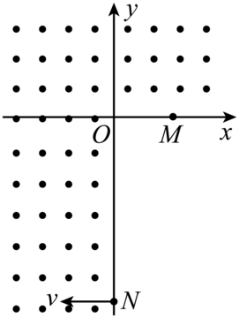

# Physics - 题目 1388

**ID**: f77466d4df35499f977530c0c2397700
**年级**: Grade 12
**难度**: Medium-Hard
**题型**: Multiple-select

## 题目
如图，xOy平面的一、二、三象限内存在垂直纸面向外，磁感应强度 $B=1{\rm{T}}$ 的匀强磁场，ON为处于y轴负方向的弹性绝缘薄挡板，长度为9m，M点为x轴正方向上一点， $OM=3{\rm{m}}$ 。​​​​​​​‌现有一个比荷大小为 $\frac {q}{m}=1.0{{\rm{C}}}/{{\rm{k}}{\rm{g}}}$ 可视为质点带正电的小球（重力不计）从挡板下端N处小孔以不同的速度向x轴负方向射入磁场，若与挡板相碰就以原速率弹回，且碰撞时间不计，碰撞时电量不变，小球最后都能经过M点，则小球射入的速度大小可能是（      ）

## 解答

1. 由题意，小球运动的圆心的位置一定在y轴上，所以小球做圆周运动的半径r一定要大于等于3m，而 $ON=9{\rm{m}}<3r$ ，所以小球最多与挡板ON碰撞一次，碰撞后，第二个圆心的位置在O点的上方。也可能小球与挡板ON没有碰撞，直接过M点，由于洛伦兹力提供向心力 $qvB=\frac {mv{^{2}}}{r}$ ，得 $v=\frac {q}{m}\cdot Br$ ，若小球与挡板ON碰撞一次，则轨迹可能如图1，设 $OO^{′}=s$ ，由几何关系得 $r{^{2}}=OM{^{2}}+s{^{2}}=9+s{^{2}}$ ， $3r-9=s$ ，联立得 $r{{}_{1}}=3{\rm{m}}$ ， $r{{}_{2}}=3.75{\rm{m}}$ ，分别代入 $v=\frac {q}{m}\cdot Br$ 得 $v{{}_{1}}=\frac {q}{m}\cdot Br{{}_{1}}=1\times 1\times 3{{\rm{m}}}/{{\rm{s}}}=3{{\rm{m}}}/{{\rm{s}}}$ ， $v{{}_{2}}=\frac {q}{m}\cdot Br{{}_{2}}=1\times 1\times 3.75{{\rm{m}}}/{{\rm{s}}}=3.75{{\rm{m}}}/{{\rm{s}}}$ ，②若小球没有与挡板ON碰撞，则轨迹如图2设 $OO^{′}=s$ ，由几何关系得 $r{{}_{3}^{2}}=OM{^{2}}+x{^{2}}=9+x{^{2}}$ ， $x=9-r{{}_{3}}$ ，联立得 $r{{}_{3}}=5{\rm{m}}$ ，代入 $v=\frac {q}{m}\cdot Br$ 得 $v{{}_{3}}=\frac {q}{m}\cdot Br{{}_{3}}=1\times 1\times 5{{\rm{m}}}/{{\rm{s}}}=5{{\rm{m}}}/{{\rm{s}}}$ 。
2. 

## 知识点

**中文**:
  - 带电粒子的运动半径和周期公式及其简单应用

**English**:
  - Radius and Period Formulas and Applications

---
