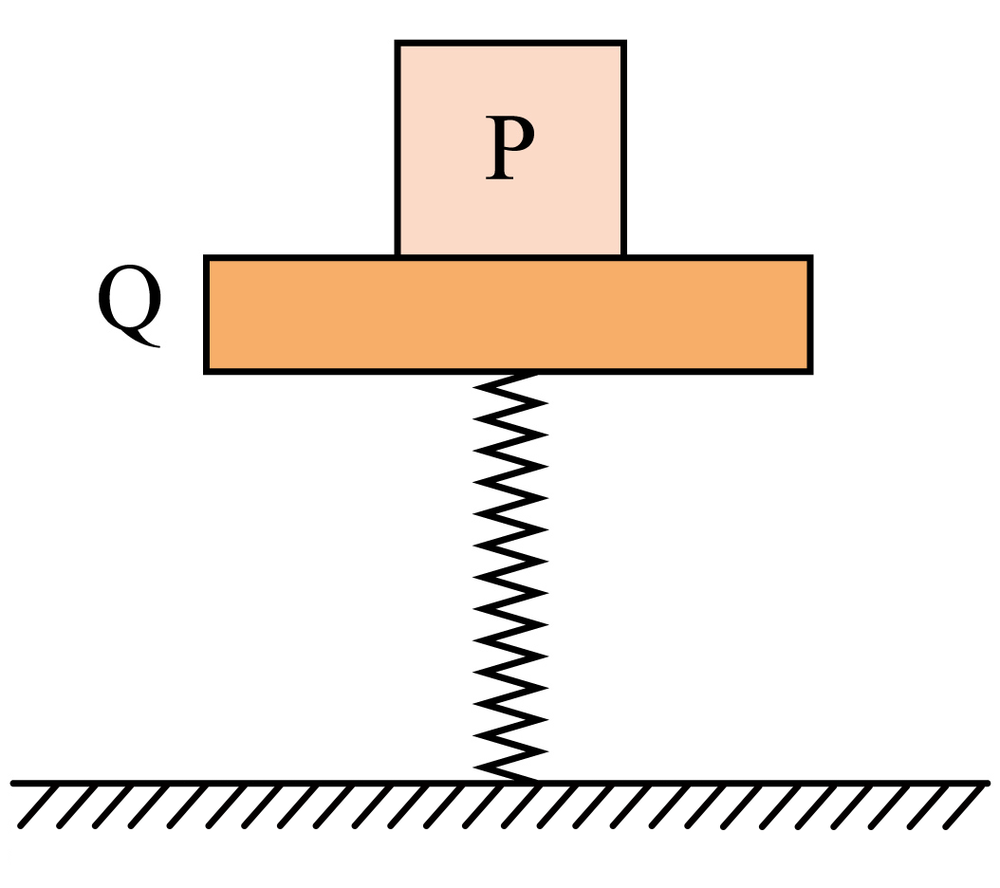

# Physics - 题目 545

**ID**: ffa21bcdb6964fa9ac044b52cccf11e1
**年级**: Grade 12
**难度**: Medium-Hard
**题型**: Multiple-select

## 题目
如图所示，直立的劲度系数为 $k$ 的轻质弹簧一端固定在水平地面，另一端与绝缘的木板 ${\rm{Q}}$ 拴接。​​​​​​​‌带电量为 $+q$ 的物块 ${\rm{P}}$ 放置在木板 ${\rm{Q}}$ 上，处于静止状态。现在系统所处空间施加一竖直向上的匀强电场，此后P、Q一起运动到最高点时恰好未分离。已知 ${\rm{P}}$ 的质量为 $2m$ ， ${\rm{Q}}$ 的质量为 $m$ ，重力加速度为 $g$ ，不计空气阻力，下列说法正确的是（      ）

## 解答

1. 由题可知，由于P、Q一起运动到最高点时恰好未分离，所以P、Q全程在做简谐运动，因此在最高点和最低点的加速度大小相同，方向相反，大小设为a，则对于最低点，弹簧弹力 $F{{}_{弹1}}$ 和P、Q重力相等，即 $F{{}_{弹{{1}}}}=3mg$ ，设施加电场后，P所受电场力大小为F，则 $F=3ma$ ，在最高点，由于P、Q刚要分离，设此时弹簧弹力为 $F{{}_{弹2}}$ ，分别对P和Q进行分析，可得 $2mg-F=2ma$ ， $mg-F{{}_{弹{{2}}}}=ma$ ，联立解得 $F=1.2mg，a=0.4g，F{{}_{弹{{2}}}}=0.6mg$ ，又因为电场力 $F=qE$ ，解得匀强电场的场强大小为 $E=\frac {1.2mg}{q}{\rm ，A}$ 错误；电场刚施加时，设P、Q间弹力大小为为N_{1}，以P为研究对象，则 $F+N{{}_{1}}-2mg=2ma$ ，解得 $N{{}_{1}}=1.6mg{\rm ，B}$ 正确；物块P的速度最大时，P、Q整体处于简谐运动平衡点，即加速度为0，设P、Q间弹力大小为N_{2}，对P则有 $F+N{{}_{2}}-2mg=0$ ，解得 $N{{}_{2}}=0.8mg{\rm ，C}$ 正确；从最低到最高系统向上运动位移为 $x=\frac {F{{}_{弹{{1}}}}}{k}-\frac {F{{}_{弹{{2}}}}}{k}=\frac {3mg}{k}-\frac {0.6mg}{k}=\frac {2.4mg}{k}$ ，系统机械能增加等于电场力对系统做功，即 $ΔE=qEx=1.2mg\times \frac {2.4mg}{k}=\frac {72g{^{2}}m{^{2}}}{25k}{\rm ，D}$ 正确。选BCD。

## 知识点

**中文**:
  - 弹簧振子及其运动特点

**English**:
  - Spring Oscillator and Motion Characteristics

---
