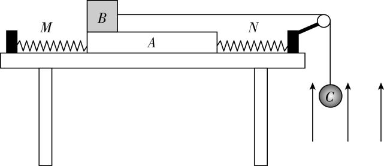

# Physics - 题目 1181

**ID**: 012abd8f057a4cc5a96a480efb5e421c
**年级**: Grade 12
**难度**: Medium-Hard
**题型**: 分，根据要求作答。

## 题目
（16分）如图，木板A放置在光滑水平桌面上，通过两根相同的水平轻弹簧M、N与桌面上的两个固定挡板相连。​​​​​​​‌小物块B放在A的最左端，通过一条跨过轻质定滑轮的轻绳与带正电的小球C相连，轻绳绝缘且不可伸长，B与滑轮间的绳子与桌面平行。桌面右侧存在一竖直向上的匀强电场，A、B、C均静止，M、N处于原长状态，轻绳处于自然伸直状态。t=0时撤去电场，C向下加速运动，下降0.2 m后开始匀速运动，C开始做匀速运动瞬间弹簧N的弹性势能为0.1 J。已知A、B、C的质量分别为0.3 kg、0.4 kg、0.2 kg，小球C的带电量为1×10^{-6}C，重力加速度大小取10 m/s^{2}，最大静摩擦力等于滑动摩擦力，弹簧始终处在弹性限度内，轻绳与滑轮间的摩擦力不计。（1）求匀强电场的场强大小；（2）求A与B间的动摩擦因数及C做匀速运动时的速度大小；（3）若t=0时电场方向改为竖直向下，当B与A即将发生相对滑动瞬间撤去电场，A、B继续向右运动，一段时间后，A从右向左运动。求A第一次从右向左运动过程中最大速度的大小。（整个过程B未与A脱离，C未与地面相碰）

## 解答

1. （1）撤去电场前，A、B、C均静止，M、N处于原长状态，将A、B作为整体，由平衡条件知绳中拉力为0，对C，根据平衡条件得qE=m_{C}g，解得E=2×10^{6}N/C。
2. （2）C开始做匀速直线运动后，根据平衡条件，对B、C分别有T_{1}=f，T'_{1}=m_{C}g
3. 其中f=μm_{B}g，T_{1}=T'_{1}，解得μ=0.5。
4. C开始匀速运动瞬间，A、B刚好发生相对滑动，A、B、C三者速度大小相等，M、N两弹簧的弹性势能相同，C下降0.2 m的过程中，对A、B、C及弹簧M、N组成的系统，由能量守恒定律得 ${\rm \mathit{m}\mathit{_{C}}\mathit{gh}=}\frac{1}{2}{\rm （\mathit{m}\mathit{_{A}}+\mathit{m}\mathit{_{B}}+\mathit{m}\mathit{_{C}}）\mathit{v}^{2}+2\mathit{E}_{p}}$ ，解得 ${\rm \mathit{v}=}\frac{2}{3}$  m/s。
5. （3）设弹簧的劲度系数为k，没有电场时，C开始匀速运动瞬间，A、B刚好发生相对滑动，故此时A的加速度为零，对A，根据平衡条件得2kh-f=0, 当电场方向改为竖直向下，设B与A即将发生相对滑动时，C下降高度为h'，对A，根据牛顿第二定律得，
6. f-2kh'=m_{A}a
7. 将B、C作为整体，根据牛顿第二定律得，
8. qE+m_{C}g-f=（m_{B}+m_{C}）a
9. 撤去电场后，由第（2）问的分析可知A、B在C下降0.2 m时开始相对滑动，在C下降0.2 m的过程中，对A、B、C及弹簧M、N组成的系统，由能量守恒定律得，
10. ${\rm \mathit{qEh~'}+\mathit{m}\mathit{_{C}}\mathit{gh}=}\frac{1}{2}{\rm （\mathit{m}\mathit{_{A}}+\mathit{m}\mathit{_{B}}+\mathit{m}\mathit{_{C}}）}$  ${v}_{\max }^{2}{\rm +2\mathit{E}_{p}}$ ，
11. 此时A的速度是其从左向右运动过程中的最大速度，此后A做简谐运动，所以A第一次从右向左运动过程中的最大速度为v'_{max}=v_{max}，
12. 联立解得 ${\rm \mathit{v~'}_{max}=}\frac{2\sqrt{2}}{3}$  m/s。

## 知识点

**中文**:
  - 功能原理、能量守恒与曲线运动的综合

**English**:
  - Energy Conservation in Curvilinear Motion

---
