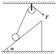

# Physics - 题目 1713

**ID**: 0aff1871f40e448d9624993b9b8408cd
**年级**: Grade 12
**难度**: Medium
**题型**: Multiple-choice

## 题目
如图所示，斜面体置于粗糙水平面上，光滑小球被轻质细线系住放在斜面上，细线另一端跨过光滑定滑轮，用力拉细线使小球沿斜面缓慢向上移动一小段距离，斜面体始终静止。​​​​​​​‌则在小球移动过程中（      ）

## 解答

1. AB．对小球受力分析并合成矢量三角形：
2. 
3. 重力大小方向不变，支持力方向不变，绳子拉力方向由图中实线变为虚线，绳子拉力增大，斜面对小球的支持力减小，A正确，B错误；
4. CD．对斜面受力分析：
5. 
6. 正交分解：
7. $N\mathrm{′}{\sin}α=f$
8. $N{{}_{地}}=N\mathrm{′}{\cos}α+Mg$
9. 根据牛顿第三定律，小球对斜面的压力 $N\mathrm{′}$ 减小，所以斜面对地面的摩擦力减小，地面对斜面的支持力减小，根据牛顿第三定律，斜面对地面的压力减小，CD错误。
10. 故选A。

## 知识点

**中文**:
  - 正交分解法与三角形定则在平衡问题中的应用
  - 相似三角形法在动态平衡问题中的应用

**English**:
  - Orthogonal Decomposition and Triangle Rule in Equilibrium
  - Similar Triangles Method for Dynamic Equilibrium

---
