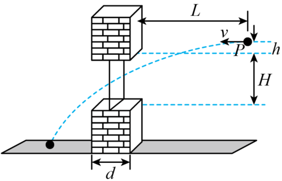

# Physics - 题目 1745

**ID**: 172eaf520fc34c87a2e0a4f36caa7331
**年级**: Grade 12
**难度**: Medium
**题型**: Multiple-choice

## 题目
如图所示，窗子上、下沿间的高度 $H=1.6{\rm{m}}$ ，墙的厚度 $d=0.4{\rm{m}}$ ，某人在离墙壁距离 $L=1.4{\rm{m}}$ ，距窗子上沿 $h=0.2{\rm{m}}$ 处的 $P$ 点，将可视为质点的小物件以 $v$ 的速度水平抛出，小物件直接穿过窗口并落在水平地面上，取 $g=10{\rm{m}}/{\rm{s}}{^{2}}$ 。​​​​​​​‌则 $v$ 的取值范围是（      ）

## 解答

1. 小物体做平抛运动，恰好擦着窗子上沿右侧穿过时v最大，此时有 $L=v{{}_{{\rm \max }}}t$ ， $h=\frac {1}{2}gt{^{2}}$ 代入数据解得v_{max}=7m/s，，恰好擦着窗口下沿左侧时速度v最小，则有 $L+d=v{{}_{{\rm \min }}}t^{′}$ ， $H+h=\frac {1}{2}gt^{′}{{^{2}}}$ ，代入数据解得v_{min}=3m/s，v的取值范围是3m/s<v<7m/s，选C。

## 知识点

**中文**:
  - 平抛运动中的临界问题

**English**:
  - Critical Problems in Horizontal Projectile Motion

---
