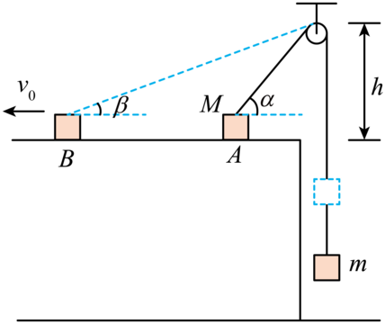

# Physics - 题目 2135

**ID**: 19f2bd60b5cf488ea67a65764ad59941
**年级**: Grade 12
**难度**: Medium
**题型**: Multiple-choice

## 题目
如图所示，两物块M和m用一根绕过定滑轮的轻绳相连。​​​​​​​‌在一定距离内，物块M在某一外力作用下能沿平台向左做匀速直线运动，并保持其速度为 $v{{}_{0}}=15{\rm{m}}{\rm{/}}{\rm{s}}$ 。与此同时，物块m随之上升。在此过程中，当物块M依次经过A、B两点时，其轻绳与水平线所成夹角各为： $α=53{}\degree $ ， $β=37{}\degree $  ，已物块m的质量为1kg，滑轮离台面高为 $h=12{\rm{m}}$ ，重力加速度 $g=10{\rm{m}}{\rm{/}}{\rm{s}}{^{2}}$ ，且物块M、m皆可视为质点。则对于物块M途经A、B两点的运动过程，下列说法中正确的是（      ）

## 解答

1. B．根据速度分解得 $v{{}_{A}}=v{{}_{0}}{\cos}53{}\degree =9{\rm{m}}{\rm{/}}{\rm{s}}$ ， $v{{}_{B}}=v{{}_{0}}{\cos}37{}\degree =12{\rm{m}}{\rm{/}}{\rm{s}}$  ，物块m做加速直线运动，B错误；
2. A．物块m上升的高度为 $h{{}_{1}}=\frac {h}{\sin 37{}\degree }-\frac {h}{\sin 53{}\degree }=5{\rm{m}}$  ，轻绳对物块m做功为 $W=\frac {1}{2}mv{{}_{B}^{2}}-\frac {1}{2}mv{{}_{A}^{2}}+mgh{{}_{1}}=81.5{\rm{J}}$  ，A错误；
3. C．运动时间为 $t=\frac {\frac {h}{{\tan}37{}\degree }-\frac {h}{{\tan}53{}\degree }}{v{{}_{0}}}=\frac {7}{15}{\rm{s}}$  ，轻绳对物块m做功的平均功率为 $P=\frac {W}{t}\approx 174.6{\rm{W}}{\rm ，C}$ 正确；
4. D．根据动量定理得 $I-mgt=mv{{}_{B}}-mv{{}_{A}}$  ，解得 $I\approx 7.7{\rm{N}}\cdot {\rm{s}}$  ，能求出轻绳对物块m的冲量大小，D错误。选C。

## 知识点

**中文**:
  - 动量定理及其应用

**English**:
  - Applications of Impulse-Momentum Theorem

---
