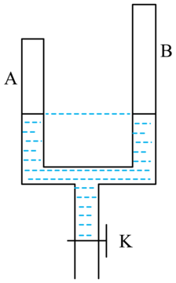

# Physics - 题目 225

**ID**: 1b3efa5e30034bbc94b84b4a90ac02fd
**年级**: Grade 12
**难度**: Medium
**题型**: Multiple-choice

## 题目
如图所示，上端均封闭的连通管道A、B中封闭着液面相平的水银柱，连通管道下部有阀门K。​​​​​​​‌A、B内的气柱长度不相同，且 $L{{}_{{\rm{B}}}}>L{{}_{{\rm{A}}}}$ ，初始状态两气柱温度相同。下列说法正确的是（      ）

## 解答

1. A、B气体温度同时缓慢升高或降低 $\Delta T$ ，假设液面不移动，两部分气体为等容变化，根据 $\frac {p}{T}=\frac {{\rm{Δ}}p}{{\rm{Δ}}T}$ ，可得 ${\rm{Δ}}p=\frac {{\rm{Δ}}T}{T}p$ ，两部分气体 $T$ 、 $p$ 、 $\Delta T$ 相同，压强的变化量相同，所以A、B液面仍相平，AB错误；打开阀门K缓慢放出少量水银柱后，假设两边液面下降后仍相平，根据等温变化的规律可得 $pL=p^{′}{\left ({L+h}\right )}$ ，可得压强为 $p^{′}=\frac {pL}{L+h}=\frac {p}{1+\frac {h}{L}}$ ，初态气柱长的 $p^{′}$ 更大，因 $L{{}_{{\rm{B}}}}>L{{}_{{\rm{A}}}}$ ，则 $p^{′}{{{}_{{\rm{B}}}}}>p^{′}{{{}_{{\rm{A}}}}}$ ，所以A的液面高于B，C正确，D错误。

## 知识点

**中文**:
  - 气体状态变化问题-U型管模型

**English**:
  - Gas State Problems: U-tube Model

---
