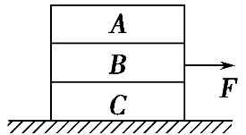

# Physics - 题目 959

**ID**: 1c3780657f7846e59536cf363cb85b7d
**年级**: Grade 12
**难度**: Medium
**题型**: Multiple-choice

## 题目
质量分别为m、2m、4m的物块A、B、C叠放在光滑的水平地面上，现对B施加一水平力F，已知A、B间和B、C间的摩擦系数均为μ，取最大静摩擦力等于滑动摩擦力，为保证它们能够一起运动，F最大值为​​​​​​​‌

## 解答

1. 对A、B、C整体分析，受重力、支持力和推力，由牛顿第二定律，有： $F=(m+2m+4m)a$ ，解得： $a=\frac {F}{7m}$ ，再对A受力分析，受重力、支持力和静摩擦力，由牛顿第二定律有： $f{{}_{BA}}=ma\leqslant {\rm μm}g$ ，对C受力分析，由牛顿第二定律，有： $f{{}_{CB}}=4ma\leqslant 3{\rm μm}g$ ，联立解得： $F\leqslant \frac {21}{4}{\rm μm}g$ ，故C正确。

## 知识点

**中文**:
  - 连接体问题（整体和隔离法）、临界问题

**English**:
  - Connected Bodies Problems (Whole/Isolation Method), Critical Problems

---
