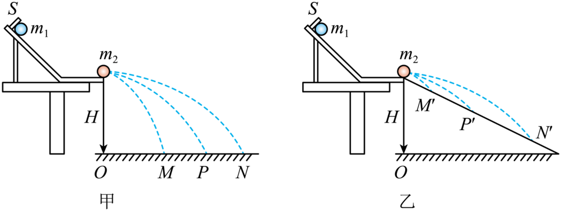

# Physics - 题目 2244

**ID**: 1dabcc5e2b4543bdbc95f143ffc209ff
**年级**: Grade 12
**难度**: Medium
**题型**: 非选择题

## 题目
某同学用如图甲所示装置验证动量守恒定律。​​​​​​​‌已知入射小球质量为m_{1}，被碰小球质量为m_{2}，记录小球抛出点在地面上的垂直投影点O。（1）关于实验要点，下列说法正确的是。

## 解答

1. （1）[1]A．为了能保证水平方向的对心碰撞，两个球的半径应该相同，A项错误；
2. B．两球不一定是弹性的，可以是非弹性的，B项错误；
3. C．斜槽可以不光滑，只要同一实验的前后两次从斜槽上同一位置由静止释放即可，C项正确；
4. D．斜槽末端必须水平，这样才能保证球从斜槽末端飞出时做平抛运动，D项正确。
5. 故选CD。
6. （2）[2]要验证的关系是
7. $m{{}_{1}}v{{}_{0}}=m{{}_{1}}v{{}_{1}}+m{{}_{2}}v{{}_{2}}$
8. 因小球做平抛运动，落地时间相等，则
9. $m{{}_{1}}\frac {L{{}_{2}}}{t}=m{{}_{1}}\frac {L{{}_{1}}}{t}+m{{}_{2}}\frac {L{{}_{3}}}{t}$
10. 即当表达式
11. $m{{}_{1}}L{{}_{2}}=m{{}_{1}}L{{}_{1}}+m{{}_{2}}L{{}_{3}}$
12. 成立时，动量守恒定律得到验证；
13. [3]当两球发生弹性碰撞时，根据能量守恒
14. $\frac {1}{2}m{{}_{1}}{\left({\frac {L{{}_{2}}}{t}}\right)^{2}}=\frac {1}{2}m{{}_{1}}{\left({\frac {L{{}_{1}}}{t}}\right)^{2}}+\frac {1}{2}m{{}_{2}}{\left({\frac {L{{}_{3}}}{t}}\right)^{2}}$
15. 得到
16. $m{{}_{1}}L{{}_{2}^{2}}=m{{}_{1}}L{{}_{1}^{2}}+m{{}_{2}}L{{}_{3}^{2}}$
17. $L{{}_{1}}+L{{}_{2}}=L{{}_{3}}$
18. 因此 $L{{}_{1}}+L{{}_{2}}=L{{}_{3}}$ 说明两球发生的是弹性碰撞；
19. （3）[4]碰撞前小球 $m{{}_{1}}$ 落点为 $P^{′}$ ，碰撞后小球 $m{{}_{1}}$ 落点为 $M^{′}$ ，小球 $m{{}_{2}}$ 落点为 $N^{′}$ ，设斜面倾角为 $α$ ，由平抛规律
20. $l{{}_{2}}{\sin}α=\frac {1}{2}gt{^{2}}$
21. $l{{}_{2}}{\cos}α=v{{}_{0}}t$
22. 得
23. $v{{}_{0}}=\sqrt {\frac {gl{{}_{2}}{\cos}{^{2}}α}{2{\sin}α}}$
24. 同理
25. $v{{}_{1}}=\sqrt {\frac {gl{{}_{1}}{\cos}{^{2}}α}{2{\sin}α}}$
26. $v{{}_{2}}=\sqrt {\frac {gl{{}_{3}}{\cos}{^{2}}α}{2{\sin}α}}$
27. 代入动量守恒表达式，得
28. $m{{}_{1}}\sqrt {l{{}_{2}}}=m{{}_{1}}\sqrt {l{{}_{1}}}+m{{}_{2}}\sqrt {l{{}_{3}}}$
29. 又
30. $m{{}_{1}}(L{{}_{2}}-L{{}_{1}})=m{{}_{2}}L{{}_{3}}$
31. $m{{}_{1}}(\sqrt {l{{}_{2}}}-\sqrt {l{{}_{1}}})=m{{}_{2}}\sqrt {l{{}_{3}}}$
32. 因此，当 $l{{}_{1}}$ 、 $l{{}_{2}}$ 、 $l{{}_{3}}$ 与 $L{{}_{1}}$ 、 $L{{}_{2}}$ 、 $L{{}_{3}}$ 之间满足关系式
33. $\frac {\sqrt {l{{}_{2}}}-\sqrt {l{{}_{1}}}}{L{{}_{2}}-L{{}_{1}}}=\frac {\sqrt {l{{}_{3}}}}{L{{}_{3}}}$
34. 则说明小球碰撞过程动量守恒。

## 知识点

**中文**:
  - 研究斜槽末端小球碰撞时的动量守恒

**English**:
  - Momentum Conservation in Collision at End of Inclined Ramp

---
