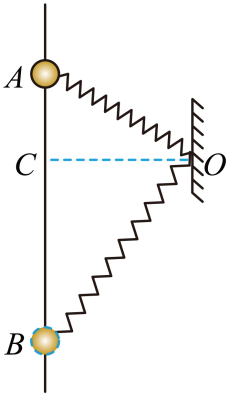

# Physics - 题目 548

**ID**: 2b854847ce9f4c999cb23acfe04170b8
**年级**: Grade 12
**难度**: Medium
**题型**: Multiple-choice

## 题目
如图所示，竖直光滑细杆上套有一小球，轻质弹簧一端连接小球，另一端固定在O点。​​​​​​​‌现将小球从A点由静止释放，最终小球能沿细杆下滑到B点，其中C点与O点等高，且CO之间的距离小于弹簧原长，则小球从A运动到B的过程中，下列说法正确的是（      ）

## 解答

1. A．由题意，可知小球到达C点时，小球受到的弹力与杆垂直，小球受到的合力等于小球的重力，小球接着将继续加速，可知小球经过C点时速度不是最大的，A错误；
2. B．由题意，可知由于小球从C到B的过程中，弹簧由压缩变为拉伸，在CB之间某一位置，弹簧处于原长，此时弹簧的弹性势能最小；由于小球从C到B先加速后减速，可知当小球的加速度为零时，小球的速度最大，动能最大，此时小球受到的弹簧弹力显然不为零，弹簧的弹性势能不是最小的，B错误；
3. C．由题意，可知小球从A到B的过程中，弹簧可能先压缩，恢复原长后再拉伸，则弹簧对小球可能先做负功，再做正功，最后做负功，C错误；
4. D．由题意，可知当小球位于C位置时，弹簧弹力与小球的运动方向垂直，此时弹簧弹力的功率为零；当小球位于C点与B点间某一位置时，弹簧刚好恢复原长，则此时弹簧弹力为零，功率为零。所以，弹簧对小球做功功率为0的位置可能有两处（不含A、B两点），D正确。选D。

## 知识点

**中文**:
  - 弹簧问题中机械能守恒定律的应用

**English**:
  - Spring Problems

---
