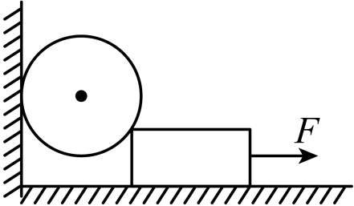

# Physics - 题目 1303

**ID**: 376d4b3c647e4c4e8d4aa15f06286ebb
**年级**: Grade 12
**难度**: Medium
**题型**: Multiple-choice

## 题目
如图所示，一质量为m的长方体物块静止在粗糙水平地面上，一重为G的光滑圆球放在光滑竖直的墙壁和长方体物块之间处于静止状态。​​​​​​​‌现用水平向右的拉力F缓慢拉动长方体物块，在圆球与地面接触之前，下列判断正确的是（      ）

## 解答

1. 对球和长方体物块整体进行受力分析，整体处于平衡状态，竖直方向有N＝mg＋G，则地面对整体的支持力不变，地面受到的摩擦力为滑动摩擦力，则有f＝μN，地面对长方体物块的摩擦力不变，A、D错误；对球进行受力分析，如图甲所示，球受力平衡，则有 ${\rm \mathit{N}_{1}＝\mathit{G}tan\mathit{θ}\mathit{，}\mathit{N}_{2}＝}\frac {G}{{\cos}θ}$ ，当用水平向右的拉力F缓慢拉动长方体物块时，θ增大，则tanθ增大，所以N_{1}增大，cosθ减小，则N_{2}增大，根据牛顿第三定律可知，球对墙壁的压力逐渐增大，B错误；对长方体物块受力分析，受到重力mg、地面的支持力N、拉力F、球对长方体物块的压力N_{2}′以及滑动摩擦力f作用，如图乙所示，受力平衡，根据牛顿第三定律可知N_{2}′＝N_{2}_{，}则水平方向有F＋N_{2}′sinθ＝f，由于N_{2}增大，θ增大，f不变，则F减小，C正确。
2. 

## 知识点

**中文**:
  - 解析法在解动态平衡问题中的应用

**English**:
  - Analytical Method for Dynamic Equilibrium

---
