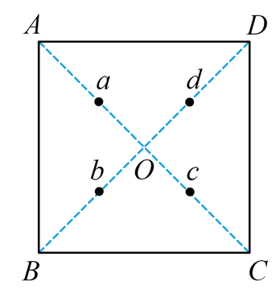

# Physics - 题目 2678

**ID**: 3912e9e4f2bc4b4890c26655f141c663
**年级**: Grade 12
**难度**: Medium
**题型**: Multiple-choice

## 题目
如图所示正方形 $ABCD$ 的四个顶点分别固定四个电荷量大小相等的点电荷（图中均未画出），其中 $A$ 、 $B$ 点为正电荷， $C$ 、 $D$ 点为负电荷，以对角线的交点 $O$ 为圆心，在正方形内画圆与对角线交于 $a$ 、 $b$ 、 $c$ 、 $d$ 四点，四点电势分别为 $φ{{}_{a}}$ 、 $φ{{}_{b}}$ 、 $φ{{}_{c}}$ 、 $φ{{}_{d}}$ ，则下列关系正确的是（      ）​​​​​​​‌

## 解答

1. 由正电荷周围的电势分布特点可知，正电荷周围的电势都是正值，且离正电荷越近电势越高。已知 $A$ 、 $B$ 点为正电荷且电荷量相等，由于 $a$ 、 $b$ 在 $A$ 、 $B$ 连线的垂直平分线上关于O点对称， $d$ 、 $c$ 也在 $A$ 、 $B$ 连线的垂直平分线上关于O点对称，根据对称性可知， $A$ 、 $B$ 点正电荷在 $a$ 、 $b$ 、 $c$ 、 $d$ 四点产生的电势大小关系为 $φ{{}_{正a}}=φ{{}_{正b}}>φ{{}_{正d}}=φ{{}_{正c}}>0$ ；同理负电荷周围的电势都是负值，且离负电荷越近电势越低。所以 $C$ 、 $D$ 点负电荷在 $a$ 、 $b$ 、 $c$ 、 $d$ 四点产生的电势大小关系为 $φ{{}_{负d}}=φ{{}_{负c}}<φ{{}_{负a}}=φ{{}_{负b}}<0$ 。所以根据电势的叠加原理（空间某点的电势等于各个点电荷单独存在时在该点产生电势的代数和）可判断 $a$ 、 $b$ 、 $c$ 、 $d$ 四点的电势大小关系为 $φ{{}_{a}}=φ{{}_{b}}>φ{{}_{d}}=φ{{}_{c}}$ 。

## 知识点

**中文**:
  - 电势

**English**:
  - Electric Potential

---
