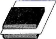

# Physics - 题目 73

**ID**: 4f3cb2707fcf41fca2b069daac716ad1
**年级**: Grade 12
**难度**: Medium
**题型**: Multiple-choice

## 题目
如图所示，一本厚度为A质量分布均匀的书放置在水平桌面上．一张A_{4}纸夹在书的最深处，A4纸与书间的动摩擦因数是书与桌面间的动摩擦因数的2倍．不计A_{4}纸的质量与厚度，要将A_{4}纸拉出，而书仍然保持不动，则A_{4}纸所夹位置离桌面的高度室少为（已知最大静摩擦力等于滑动摩擦力）​​​​​​​‌

## 解答

1. 设书与桌面间的动摩擦因数是μ，则A4纸与书间的动摩擦因数2μ，设书的质量为M，恰好能被拉动，A4纸对字典的摩擦力f=f_{桌}；f_{桌}=μMg；设此时A4纸上方纸张质量为m，则有：2×2μmg=f； 又由于书的质量是均匀分布的，所以高度h与d之间的关系为： $\frac {d-h}{d}＝\frac {m}{M}$
2. 联立解得：h= $\frac {3}{4}$d．故A正确，BCD错误．故选A.

## 知识点

**中文**:
  - 静摩擦力和最大静摩擦力

**English**:
  - Static Friction and Maximum Static Friction

---
