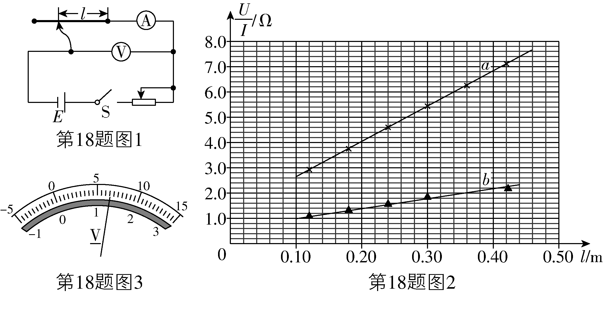

# Physics - 题目 457

**ID**: 5310258c7cdc441698f7932dab06c522
**年级**: Grade 12
**难度**: Medium
**题型**: 非选择题(本题共6小题，共55分)

## 题目
(7分)小明同学根据图1的电路连接器材来“探究导体电阻与其影响因素的定量关系”。​​​​​​​‌实验时多次改变合金丝甲接入电路的长度l、调节滑动变阻器的阻值，使电流表的读数I达到某一相同值时记录电压表的示数U，从而得到多个 $\frac {U}{I}$ 的值，作出 $\frac {U}{I}$ －l图像，如图2中图线a所示。(1)在实验中使用的是(填“0～20 Ω”或“0～200 Ω”)的滑动变阻器。(2)在某次测量时，电压表的指针位置如图3所示，则读数U＝V。(3)已知合金丝甲的横截面积为7.0×10^{－}^{8}m^{2}，则合金丝甲的电阻率为Ω·m(结果保留2位有效数字)。(4)图2中图线b是另一根长度相同、材料相同的合金丝乙与合金丝甲并联后采用同样的方法获得的 $\frac {U}{I}$ －l图像，由图可知合金丝甲的横截面积(填“大于”“等于”或“小于”)合金丝乙的横截面积。

## 解答

1. 本题考查探究导体电阻与其影响因素的定量关系实验。
2. (1)由实验原理可知R_{x}＝ $\frac {U}{I}$ ，而由 $\frac {U}{I}$ －l图像可知待测电阻最大约为8 Ω，为了使电压表有明显的读数变化且便于调节，滑动变阻器的最大阻值不能太大，故选0～20 Ω比较合适。
3. (2)避免电流过大，产生较大热量，致使电阻率发生变化，故电压表量程为3 V，精度为0.1 V，估读到0.01 V，则电压为1.32 V(1.31～1.34均可)。
4. (3)根据电阻定律有 $\frac {U}{I}$ ＝R_{x}＝ $\frac {ρ}{S}$ ·l，则 $\frac {U}{I}$ －l图像的斜率为k＝ $\frac {ρ}{S}$ ，可得合金丝甲的电阻率ρ＝kS＝ $\frac {7.44.0}{0.440.20}$ ×7.0×10^{－}^{8}Ω·m≈0.99×10^{－}^{6}Ω·m(0.96×10^{－}^{6}～1.0×10^{－}^{6}均可)。
5. (4)另一根长度相同、材料相同的合金丝乙与合金丝甲并联后，电阻率不变，而横截面积变为S′＝S＋S_{乙}，由题图2中图线b可得S′＝ $\frac {ρ}{k{{}_{b}}}$ ＝ $\frac {0.99\times 10{^{-6}}}{\frac {2.2-1.4}{0.42-0.20}}$  m^{2}≈27.2×10^{－}^{8}m^{2}，则S_{乙}＝S′－S≈20.2×10^{－}^{8}m^{2}>S，故合金丝甲的横截面积小于合金丝乙的横截面积。

## 知识点

**中文**:
  - 实验：探究影响电阻的因素

**English**:
  - Experiment: Factors Affecting Resistance

---
