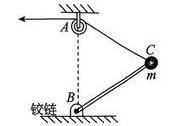

# Physics - 题目 1553

**ID**: 53729fe11ac6474d8a769d5ab7ccd316
**年级**: Grade 12
**难度**: Medium
**题型**: 单项选择题

## 题目
如图所示，定滑轮 $A$ （形状忽略不计）固定在天花板上，轮轴与表面均光滑，水平地面上固定铰链 $B$ （形状忽略不计）， $B$ 在 $A$ 的正下方，轻质硬直杆一端连接 $B$ ，另一端连接质量为 $m$ 的小球 $C$ （视为质点），轻质细线跨过 $A$ ，左端施加力 $F{{}_{1}}$ （为未知量），系统处于第一个静止状态，三角形 $ABC$ 为边长为 $d$ 正三角形；再让 $A、C$ 间的距离变为0.​​​​​​​‌5d，系统处于第二个静止状态，轻绳左端施加的力为 $F{{}_{2}}$ （为未知量），重力加速度为 $g$ ，则两种静止状态下（      ）

## 解答

1. 对小球进行受力分析，当小球处于静止状态时，处于三力平衡状态，三力平衡构建的矢量三角形与三角形 $ABC$ 相似，设两种静止状态下，杆对小球弹力大小分别为 $F{{}_{{\rm{N}}{{1}}}},F{{}_{{\rm{N}}2}}$ ，由相似三角形的比例关系可得 $\frac {mg}{h}=\frac {F{{}_{N1}}}{h}=\frac {F{{}_{1}}}{h}\frac {mg}{h}=\frac {F{{}_{N2}}}{h}=\frac {F{{}_{2}}}{0.5h}$ ，则有 $F{{}_{N1}}=F{{}_{N2}}=mg,F{{}_{1}}=mg,F{{}_{2}}=0.5mg,F{{}_{1}}=2F{{}_{2}},{\rm{A}}$ 错误、C正确；杆对小球的弹力总沿着杆，两种静止状态下，弹力方向不同，B错误；细线对小球的拉力与小球重力的合力与杆对小球的弹力等大反向，则细线对小球的拉力与小球重力的合力一定沿着杆，D错误。

## 知识点

**中文**:
  - 正交分解法与三角形定则在平衡问题中的应用

**English**:
  - Orthogonal Decomposition and Triangle Rule in Equilibrium

---
