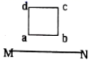

# Physics - 题目 1116

**ID**: 5659b83938104ebbb35a9cd3308bb299
**年级**: Grade 12
**难度**: Medium
**题型**: Multiple-choice

## 题目
如图，矩形导线框abcd与长直导线MN在同一竖直平面内，ab、cd与MN平行，若MN中通过的电流强度逐渐减小，则ab边所受磁场力的方向（      ）​​​​​​​‌

## 解答

1. 由于电流的减小，所以导致线圈磁通量减小，从而产生感应电流，因处于磁场中，受到磁场力使其阻碍磁通量变小，所以靠近通电导线．由于靠近导线磁场越强，所以ab边受到的磁场力一定竖直向下，故D正确，ABC错误，故选D．

## 知识点

**中文**:
  - 楞次定律及其应用

**English**:
  - Lenz's Law and Applications

---
