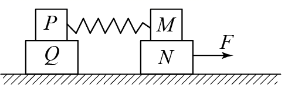

# Physics - 题目 1219

**ID**: 588feb237e654bcb9800d1fdebb96309
**年级**: Grade 12
**难度**: Medium
**题型**: Multiple-choice

## 题目
如图所示，光滑水平面上放置M、N、P、Q四个木块，其中 $M$ 、 $P$ 质量均为 $m$ ，N、Q质量均为 $2m$ ，M、P之间用一轻质弹簧相连。​​​​​​​‌现用水平拉力 $F$ 拉 $N$ ，使四个木块以同一加速度 $a$ 向右运动，则在突然撤去 $F$ 的瞬间，下列说法正确的是（      ）

## 解答

1. A．四个物体一起做匀加速运动，把四个物体看成整体，由牛顿第二定律得
2. $F=6ma$
3. 对N应用牛顿第二定律有
4. $F-F{{}_{f}}=2ma$
5. 则M、N间的静摩擦力
6. $F{{}_{f}}=4ma=\frac {2}{3}F$
7. 对M应用牛顿第二定律，有
8. $F{{}_{f}}-F{{}_{T}}=ma$
9. 则弹簧的拉力
10. $F{{}_{T}}=3ma=\frac {1}{2}F$
11. 当突然撤去外力F，弹簧弹力不发生突变，P、Q的加速度不变，P、Q间的摩擦力不变，故A错误；
12. BCD．弹簧的弹力使M、N整体产生向左的加速度
13. $F{{}_{T}}=3ma^{′}$
14. 得 $a^{′}=a$ ，即M、N的加速度大小不变，此时M、N间的摩擦力大小 $F{{}_{f}^{^{′}}}$ ，对 $N$ 应用牛顿第二定律，有
15. $F{{}_{f}^{^{′}}}=2ma^{′}=\frac {1}{3}F$
16. 故BD错误，C正确。
17. 故选C。

## 知识点

**中文**:
  - 连接体问题（整体和隔离法）、临界问题

**English**:
  - Connected Bodies Problems (Whole/Isolation Method), Critical Problems

---
