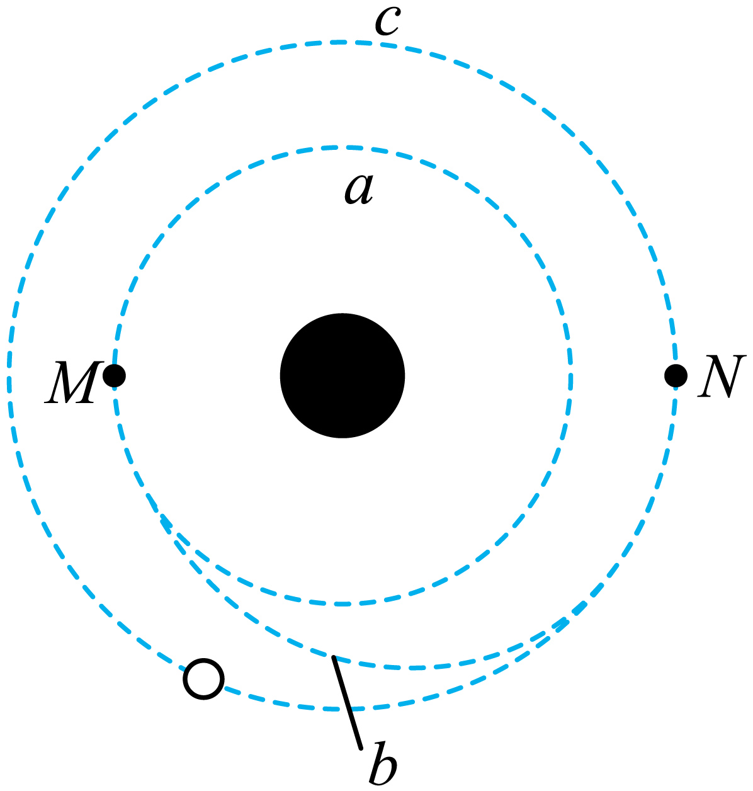

# Physics - 题目 507

**ID**: 5b7c34e39642495884a7bd37299416a5
**年级**: Grade 12
**难度**: Medium
**题型**: Multiple-choice

## 题目
我国在西昌卫星发射中心使用长征四号乙运载火箭，成功将遥感四十三号01组卫星发射升空。​​​​​​​‌如图为遥感四十三号01组卫星发射过程的示意图，首先将卫星发射到低空圆轨道a，然后在M点实施变轨经椭圆轨道b进入预定圆轨道c，已知a和c的轨道半径之比为 $r{{}_{a}}{\rm{\;}}∶r{{}_{c}}=2{\rm{\;}}∶{\rm{\;}}3$ 。下列说法正确的是（      ）

## 解答

1. 卫星由轨道a进入轨道b，即由低轨道进入高轨道，应在M点加速，同理，卫星由轨道b进入轨道c，应在N点加速，A错误；由题意 $r{{}_{a}}{\rm{\;}}∶r{{}_{c}}=2{\rm{\;}}∶{\rm{\;}}3$ ，则卫星在轨道a的半径与椭圆轨道b的半长轴之比为4∶5，由开普勒第三定律得 $\frac {r{{}_{a}^{3}}}{r{{}_{b}^{3}}}=\frac {T{{}_{a}^{2}}}{T{{}_{b}^{2}}}$ ，解得 $T{{}_{a}}{\rm{\;}}∶T{{}_{b}}=8{\rm{\;}}∶{\rm{\;}}5\sqrt {5}{\rm ，B}$ 正确；由万有引力提供向心力可得 $G\frac {Mm}{r{^{2}}}=m\frac {v{^{2}}}{r}$ ，解得 $v=\sqrt {\frac {GM}{r}}$ ，则卫星在轨道a过M点的速度大于卫星在轨道c过N点的速度，又因为卫星从轨道a的M点应加速才能进入轨道b，在轨道b过M点的速度大于在轨道a过M点的速度，可得在轨道b过M点的速度大于在轨道c过N点的速度，C错误；由 $G\frac {Mm}{r{^{2}}}=ma$ 可得 $a=G\frac {M}{r{^{2}}}$ ，则卫星在M点的加速度大于在N点的加速度，D错误。

## 知识点

**中文**:
  - 卫星变轨与对接问题

**English**:
  - Satellite Orbit Change and Docking

---
