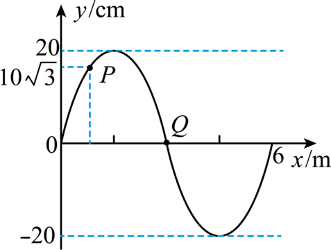

# Physics - 题目 2430

**ID**: 61a3cd08e633473d9a6f657a2ab57654
**年级**: Grade 12
**难度**: Medium
**题型**: Multiple-choice

## 题目
一列简谐横波沿x轴正方向传播， $t=0$ 时刻的波形如图所示，P、Q两质点的位移分别为 $y{{}_{P}}=10\sqrt {3}{\rm{c}}{\rm{m}}$ ， $y{{}_{Q}}=0$ ，已知波的周期 $T=6{\rm{s}}$ ，下列说法正确的是（      ）​​​​​​​‌

## 解答

1. 简谐横波沿x轴正方向传播，由“同侧法”可知， $t=0$ 时，质点P沿y轴负方向振动，选项A错误；对质点P因 $y=A\sin \frac {2π}{λ}x$ ，即 $10\sqrt {3}=20\sin \frac {2π}{6}x$ ，解得 $x=1{\rm{m}}$ ，质点P的平衡位置在 $x=1{\rm{m}}$ 处，选项B错误； $t=0$ 时，质点P沿y轴负方向振动，可知质点P的振动方程为 $y=A\sin (\frac {2π}{T}t+φ)=20\sin (\frac {2π}{6}t+\frac {2π}{3}){\rm{c}}{\rm{m}}$ ，可知 $t=2{\rm{s}}$ 时，P点位移为 $y=-10\sqrt {3}{\rm{c}}{\rm{m}}$ ，选项C错误；质点Q的振动方程为 $y{^{^{′}}}=A\sin \frac {2π}{T}t=20\sin \frac {π}{3}t({\rm{c}}{\rm{m}}{\rm{)}}$ ，把t=2s代入，解得 $y{^{^{′}}}=10\sqrt {3}{\rm{c}}{\rm{m}}$ ，且知道此时质点P和Q的运动方向均为沿y轴负方向运动，根据对称性可知，此时P、Q两质点的速度大小相等，D正确。

## 知识点

**中文**:
  - 振幅、周期、频率、相位和波长及其计算
  - 简谐运动的函数与图像

**English**:
  - Calculation of Amplitude, Period, Frequency, Phase, and Wavelength
  - Functions and Graphs of SHM

---
