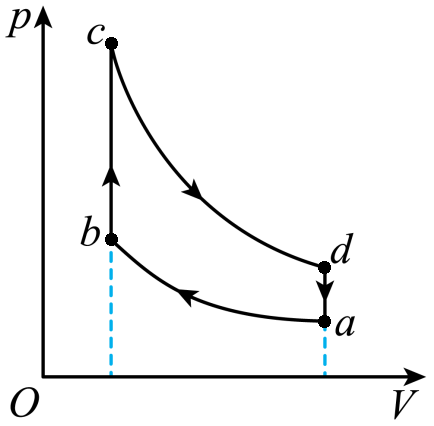

# Physics - 题目 712

**ID**: 646014d732684d81b16163e7550b5acd
**年级**: Grade 12
**难度**: Medium
**题型**: Multiple-choice

## 题目
在四冲程内燃机的奥托循环中，一定质量的理想气体经历两个绝热和两个等容的循环过程，从状态a依次经过状态b、c和d后再回到状态a，其p-V图像如图所示。​​​​​​​‌下列说法正确的是（      ）

## 解答

1. 从状态a到b是绝热过程，体积减小，外界对气体做正功，根据热力学第一定律可知，气体内能增加，则气体在状态a时的内能小于状态b时的内能 ，A错误；由于气体在状态a时的内能小于状态b时的内能，理想气体分子势能不计，则分子平均动能满足 $E{{}_{{\rm{k}}a}}<E{{}_{{\rm{k}}b}}$  ，B错误；从状态c到d为绝热过程，体积增大，气体对外界做正功，内能减少，分子平均动能减小，分子数密度减小，则单位时间内气体分子对汽缸壁单位面积的碰撞次数一定减小 ，C正确；由状态a经b到c的过程中，外界对气体做的正功为 $W{{}_{1}}$ ，吸收的热量为 $Q{{}_{1}}$ ，由状态c经d到a过程中，气体对外界做的正功为 $W{{}_{2}}$ ，放出的热量为 $Q{{}_{2}}$ ，由热力学第一定律可得 $ΔU=W{{}_{1}}+Q{{}_{1}}-W{{}_{2}}-Q{{}_{2}}=0{\rm \mathit{p-V}}$ 图像中，图线与坐标轴所围成的面积表示外界对气体做功的绝对值，则有 $W{{}_{1}}<W{{}_{2}}$ ，所以 $Q{{}_{1}}-Q{{}_{2}}=W{{}_{2}}-W{{}_{1}}>0$ ，则由状态a经b到c的过程中，气体吸收的热量大于由状态c经d到a过程中放出的热量 ，D错误。

## 知识点

**中文**:
  - 气体的p-V图像问题

**English**:
  - p-V Graph Problems

---
