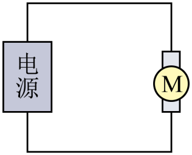

# Physics - 题目 1113

**ID**: 67593d5cd61f45ee9c44dc1363362fd0
**年级**: Grade 12
**难度**: Medium
**题型**: Multiple-choice

## 题目
某款电动自行车的内部电路可简化为如图所示，电源铭牌上标有“36V，12Ah”字样。​​​​​​​‌正常工作时，电源的输出功率为180W，工作效率为75%，电动机机械效率为80%。已知自行车运动时受到阻力恒为40N。正常工作时（      ）

## 解答

1. AB．正常工作时，电源的输出功率为180W，工作效率为75%，则电源的输入功率为
2. $P_{输入}=\frac {P_{输出}}{η_{1}}=\frac {180}{75\%}{\rm{W}}=240{\rm{W}}$
3. 且由公式
4. $P=UI$
5. 解得电动机的额定电流约为
6. $I=\frac {P_{输入}}{U_{额}}=\frac {240}{36}{\rm{A}}\approx 6.7{\rm{A}}$
7. 设电动机的内阻为 $r_{{\rm{M}}}$ ，电动机的效率为80%，则
8. $P-0.8P=I^{2}r_{{\rm{M}}}$
9. 解得
10. $r_{{\rm{M}}}=\frac {(1-0.8)\times 180}{6.7^{2}}{\rm{Ω}}\approx 0.8{\rm{Ω}}$
11. 由于电源与电动机都有内阻，故电动机两端电压
12. $U=\frac {P}{I}=\frac {180}{6.7}{\rm{V}}\approx 27{\rm{V}}$
13. 故AB错误；
14. CD．根据电池容量 $Q=12{\rm{A}}{\rm{h}}$ ，电流为 $6.7{\rm{A}}$ ，则可得
15. $t=\frac {Q}{I}=\frac {12}{6.7}{\rm{h}}\approx 1.8{\rm{h}}$
16. 自行车匀速行驶时
17. $F=f$
18. 则由
19. $80\%P=fv$
20. 解得
21. $v=3.6{\rm{m}}{\rm{/}}{\rm{s}}$
22. 自行车匀速行驶的最远距离约为
23. $x=vt=1.8\times 3600\times 3.6{\rm{m}}=23.328{\rm{k}}{\rm{m}}$
24. 故C正确，D错误。
25. 故选C。

## 知识点

**中文**:
  - 非纯电阻电路中的电功、电功率和电热

**English**:
  - Work, Power, and Heat in Non-Pure Resistive Circuits

---
