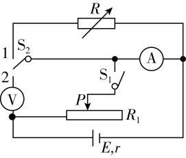
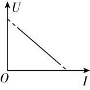

# Physics - 题目 376

**ID**: 6935490d87404a6c824965b4d7931318
**年级**: Grade 12
**难度**: Medium
**题型**: 非选择题（本大题共5小题，共56分）

## 题目
（10分）为了响应绿色、开放、共享的新发展理念，岳阳市将大力发展光伏发电。​​​​​​​‌光伏电池是将太阳能转化为电能的装置，目前已广泛应用于人们生活的各个方面。小王家就安装了一套太阳能庭院灯，小王拆下了其中的光伏电池，欲测量其电动势和内阻。通过查阅铭牌，他们了解到电池规格为“ $12\mathrm{V}$ ; $2\mathrm{\Omega }$  ; $6\mathrm{A}\cdot \mathrm{h}$ ”，高亮度 $\mathrm{L}\mathrm{E}\mathrm{D}$ 照明灯的规格为“ $5\mathrm{W}$ ; $10\mathrm{V}$ ”。（1） 若通过分压电阻保证 $\mathrm{L}\mathrm{E}\mathrm{D}$ 灯正常发光，则给光伏电池充满电后，理论上可使 $\mathrm{L}\mathrm{E}\mathrm{D}$ 灯连续照明$\mathrm{h}$ ;（2） 实验室可提供的器材如下：电流表 ${\rm A}($ 量程 $0.6\mathrm{A}$ ，内阻约为 $2\mathrm{\Omega })$电压表 $\mathrm{V}($ 量程 $15\mathrm{V}$ ，内阻约为 $10\mathrm{k}\mathrm{\Omega })$滑动变阻器 ${R}_{1}(0\sim 20\mathrm{\Omega })$电阻箱 ${R}_{2}($ 最大阻值 $99\mathrm{\Omega }$  ，最小分度 $0.1\mathrm{\Omega })$电阻箱 ${R}_{3}($ 最大阻值 $999\mathrm{\Omega }$  ，最小分度 $1\mathrm{\Omega })$单刀单掷开关 ${\mathrm{S}}_{1}$ 、单刀双掷开关 ${\mathrm{S}}_{2}$ 及导线若干为测量该电池的电动势和内阻，该小组设计了如图（a）所示的电路，并按以下步骤进行操作：图（a）    	图（b）①闭合开关 ${\mathrm{S}}_{1}$ ，断开开关 ${\mathrm{S}}_{2}$ ，调节滑动变阻器 ${R}_{1}$ 使电流表指针满偏;②保持滑片 $P$ 不动，把开关 ${\mathrm{S}}_{2}$ 与1接通，调节电阻箱使电流表读数为 $0.4\mathrm{A}$ ,读出电阻箱的阻值 ${r}_{0}$ ，其中电阻箱应选择（填“ ${R}_{2}$ ”或“ ${R}_{3}$ ”）;则可得电流表的内阻 ${R}_{\mathrm{A}}=$。③闭合开关 ${\mathrm{S}}_{1}$ ，把开关 ${\mathrm{S}}_{2}$ 与2接通，调节滑动变阻器阻值，记下多组电流表的示数 $I$ 和相应电压表的示数 $U$ ;④以 $U$ 为纵坐标， $I$ 为横坐标，作出 $U-I$ 图线如图（b）所示，图线斜率的绝对值为 $k$ ，纵截距为 $b$ ，根据图线求得电动势 $E=$，内阻 $r=$。

## 解答

1. （1）  $\mathrm{L}\mathrm{E}\mathrm{D}$ 灯正常发光，则 ${U}_{\mathrm{L}}It=Pt$ ，解得 $t=\frac{{U}_{\mathrm{L}}It}{P}=\frac{10\mathrm{V}×6\mathrm{A}\cdot \mathrm{h}}{5\mathrm{W}}=12\mathrm{h}$ 。
2. （2） ②该电流表的内阻约为 $2\mathrm{\Omega }$  ，故电阻箱应选分度值为 $0.1\mathrm{\Omega }$  的 ${R}_{2}$ ；闭合开关 ${\mathrm{S}}_{1}$ ，断开开关 ${\mathrm{S}}_{2}$ ，电流表为 $I=0.6\mathrm{A}$ ， ${\mathrm{S}}_{2}$ 接1时， ${I}_{1}=0.4\mathrm{A}$ ，则通过电阻箱的电流 ${I}_{2}=I-{I}_{1}=0.2\mathrm{A}$ ，则 $\frac{{R}_{\mathrm{A}}}{{r}_{0}}=\frac{{I}_{2}}{{I}_{1}}$ ，解得 ${R}_{\mathrm{A}}=\frac{1}{2}{r}_{0}$ ；④由闭合电路欧姆定律得 $E=U+I({R}_{\mathrm{A}}+r)$ ，整理得 $U=E-I({R}_{\mathrm{A}}+r)$ ，则 $E=b$ ， ${R}_{\mathrm{A}}+r=k$ ，整理得 $r=k-\frac{1}{2}{r}_{0}$ 。

## 知识点

**中文**:
  - 实验：电池电动势和内阻的测量—伏安法测量电源电动势与内阻

**English**:
  - V-A Method for EMF and Internal Resistance

---
