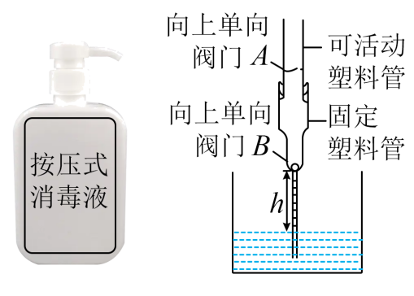

# Physics - 题目 466

**ID**: 6c61df6c0db64a1fab101ca59d1391f5
**年级**: Grade 12
**难度**: Medium
**题型**: 非选择题

## 题目
如图所示为某款按压式免洗消毒液容器的原理简易图，当向下按压顶盖时同时带动可活动塑料管往下移动，固定塑料管内气体的压强变大，此时向上单向阀门A自动打开，管内气体流出。​​​​​​​‌当可活动塑料管压至最低位置，设此时固定塑料管内气体的压强和体积分别为p_{0}和V_{0}；松开手后，可活动塑料管在弹力装置的作用下往上弹开，固定塑料管内气体的体积变大、压强变小，向上单向阀门A闭合；当固定塑料管内气体的体积变大到一定程度后，液体能通过向上单向阀门B进入固定塑料管内，假设初始时向上单向阀门B到瓶内液体上表面的距离为h，向上单向阀门B的质量为m，其下端管道横截面积为S，瓶内液体密度为ρ，重力加速度为g。整个过程认为气体的温度保持不变，外界气体压强为p_{0}，求：（1）向上单向阀门B刚被顶开时，固定塑料管内气体的压强；（2）向上单向阀门B刚被顶开时，固定塑料管内气体的体积V_{1}。

## 解答

1. （1）设向上单向阀门B恰好要被顶开时，固定塑料管内气体压强为p_{1}，体积为V_{1}，对向上单向阀门B，列平衡方程，有 $p{{}_{1}}S+mg=\left ({p{{}_{0}}-ρgh}\right )S$ 整理得 $p{{}_{1}}=p{{}_{0}}-ρgh-\frac {mg}{S}$ 。
2. （2）从可活动塑料管压至最低位置到向上单向阀门B将被顶开过程，对固定塑料管内气体，根据玻意耳定律有 $p{{}_{0}}V{{}_{0}}=p{{}_{1}}V{{}_{1}}$ 解得 $V{{}_{1}}=\frac {p{{}_{0}}V{{}_{0}}S}{p{{}_{0}}S-mg-ρghS}$

## 知识点

**中文**:
  - 充气、抽气和灌气等问题

**English**:
  - Inflation, Evacuation, and Filling Problems

---
