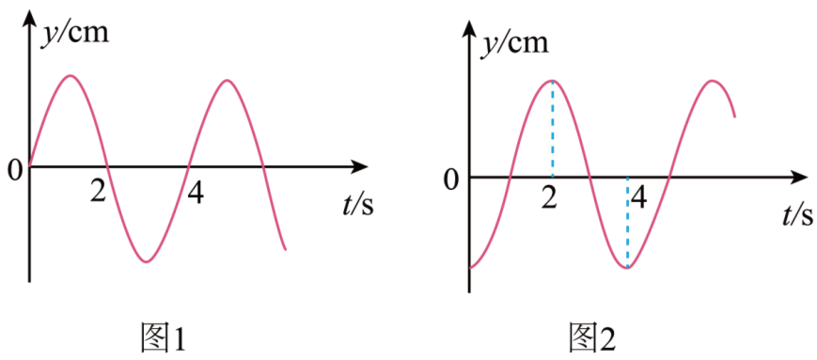

# Physics - 题目 2284

**ID**: 73bc18ecc57743e3ab4be6ace1d5531b
**年级**: Grade 12
**难度**: Medium
**题型**: Multiple-choice

## 题目
一列简谐横波沿x轴传播，图1、图2分别是x轴上相距1m的M、N两点的振动图像。​​​​​​​‌下列说法正确的是（      ）

## 解答

1. A．由图可知 $2\sim 3{\rm s}$ 内M、N两点的振动方向相同，A错误；
2. BC．由图可知M、N两点的平衡位置相距 $\Delta x=1{\rm m}=\left ({n+\frac {1}{4}}\right )λ\left ({n=0,1,2，\cdots }\right )$ ，当 $n=0$ 时 $λ=4{\rm m}$ ，当 $n=1$ 时 $λ=0.8{\rm m}$ ，BC错误；
3. D．由图可知，周期为 $T=4{\rm s}$ ，如果该简谐横波的波速为 $\frac {1}{17}{\rm m}/{\rm s}$ ，则波长为 $λ=vT=\frac {4}{17}{\rm m}$ ，由 $\Delta x=1{\rm m}=\left ({n+\frac {1}{4}}\right )λ\left ({n=0,1,2，\cdots }\right )$ ，解得 $n=4$ ，D正确。选D。

## 知识点

**中文**:
  - 波的多解问题

**English**:
  - Multi-solution Problems in Waves

---
