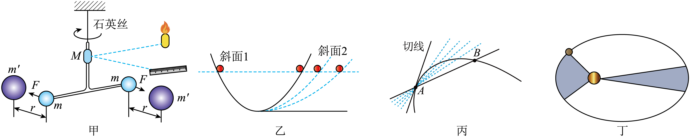

# Physics - 题目 750

**ID**: 75120c32a9474f8bba562aba1df31aba
**年级**: Grade 12
**难度**: Medium
**题型**: Multiple-choice

## 题目
物理学的发展历史和其中蕴含的丰富物理思想或方法是人类智慧的巨大财富，下列关于四幅图所涉及的知识叙述正确的是（      ）​​​​​​​‌

## 解答

1. 牛顿发现了万有引力定律，但万有引力常量是由卡文迪什通过引力扭秤实验测出的，A错误；伽利略根据理想斜面实验，提出了力不是维持物体运动的原因，B正确；在轨迹曲线上的某一点A附近另取一点B，构成一段位移，当点B不断逼近点A，位移无限趋近于零时，该位移方向为点A处的切线方向，即速度方向。在理论上，这种分析运用了“极限”思想，C错误；是开普勒通过大量天文观测数据总结了行星运行的规律，并非第谷，D错误。

## 知识点

**中文**:
  - 万有引力定律
  - 伽利略的理想斜面实验
  - 开普勒三大定律及其应用
  - 万有引力常量的测定

**English**:
  - Law of Universal Gravitation
  - Galileo's Ideal Inclined Plane Experiment
  - Kepler's Three Laws and Applications
  - Measurement of Gravitational Constant

---
