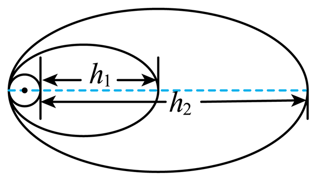

# Physics - 题目 1594

**ID**: 77ad8a9a679f4c5db5ba73cfb76ac99e
**年级**: Grade 12
**难度**: Medium
**题型**: Multiple-choice

## 题目
如图所示，有两颗卫星绕某星球做椭圆轨道运动，两颗卫星的近地点均与星球表面很近（可视为相切），卫星1和卫星2的轨道远地点到星球表面的最近距离分别为 $h{{}_{1}}$ 、 $h{{}_{2}}$ ，卫星1和卫星2的环绕周期之比为 $k$ 。​​​​​​​‌忽略星球自转的影响，已知引力常量为 $G$ ，星球表面的重力加速度为 $g{{}_{c}}$ 。则星球的平均密度为（      ）

## 解答

1. 卫星（一）卫星二轨道的半长轴分别为 $a{{}_{1}}=\frac {2R+h{{}_{1}}}{2}$ ， $a{{}_{2}}=\frac {2R+h{{}_{2}}}{2}$ ，由开普勒第三定律得 $\frac {T{{}_{1}}}{T{{}_{2}}}=\sqrt {\frac {a{{}_{1}^{3}}}{a{{}_{2}^{3}}}}=k$ ，整理得 $R=\frac {h{{}_{1}}-k{^{\frac {2}{3}}}h{{}_{2}}}{2\left ({k{^{\frac {2}{3}}}-1}\right )}$ ，星球表面的重力加速度为g_{c}，根据万有引力提供重力得 $G\frac {Mm}{R{^{2}}}=mg{{}_{c}}$ ，星球质量的表达式为 $M=\frac {4π}{3}ρR{^{3}}$ ，联立得 $ρ=\frac {3g{{}_{c}}}{4πGR}=\frac {3g{{}_{c}}\left ({1-k{^{\frac {2}{3}}}}\right )}{2πG\left ({h{{}_{2}}k{^{\frac {2}{3}}}-h{{}_{1}}}\right )}$ 。

## 知识点

**中文**:
  - 天体密度的计算

**English**:
  - Calculation of Celestial Density

---
