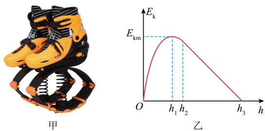

# Physics - 题目 309

**ID**: 7895a67dd81f47579b9c43c8a2a5b796
**年级**: Grade 12
**难度**: Medium
**题型**: Multiple-choice

## 题目
如图甲所示，弹跳鞋是一种新型体育用品鞋，其底部装有弹簧。​​​​​​​‌某次弹跳从最高点下落的过程中，人的动能 $E{{}_{{\rm{k}}}}$ 随重心高度h（最低点为 ${\rm \mathit{h}}=$ 0）变化的图像如图乙所示，图中 $h{{}_{2}}\sim h{{}_{3}}$ 段为直线，其余部分为曲线，已知弹簧始终处于弹性限度内，空气阻力忽略不计，人看作质点。则（      ）

## 解答

1. 上升高度为 $h{{}_{1}}$ 时，人的动能最大，速度最大，加速度为零，A错误；最高点下落到h_{1}的过程中，图中 $h{{}_{2}}\sim h{{}_{3}}$ 段为直线，人只受重力作用，即下落到 $h{{}_{2}}$ 的过程中，人的机械能守恒， $h{{}_{2}}\sim h{{}_{1}}$ 阶段人做方向向下的加速度减小的加速运动，此时有弹力作用，弹簧处于压缩状态，对人做负功，人的机械能减小，B错误，D错误；高度为 ${\rm \mathit{h}}={\rm 0}$ 时，下降到最低点，人的动能为零，速度向下减为零，加速度向上，人处于超重状态，C正确。

## 知识点

**中文**:
  - 弹簧问题中机械能守恒定律的应用

**English**:
  - Spring Problems

---
