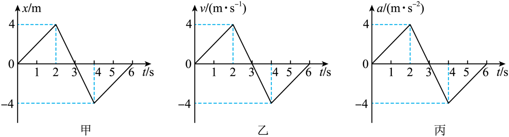

# Physics - 题目 2260

**ID**: 817579923dfd4e3e803fbd80110aa33b
**年级**: Grade 12
**难度**: Medium
**题型**: Multiple-choice

## 题目
甲、乙、丙三个物体的运动图像分别如图所示，已知丙物体的初速度为零。​​​​​​​‌关于三个物体在 $0\sim 6{\rm{s}}$ 时间内的运动，下列说法正确的是（      ）

## 解答

1. 由图可知，甲物体做往复运动，且 ${{2}}{\rm{s}}$ 和 ${{4}}{\rm{s}}$ 时距离出发点最远；乙物体在 $0\sim 3{\rm{s}}$ 内沿正方向运动， $3\sim 6{\rm{s}}$ 内沿负方向运动，且 $3{\rm{s}}$ 时距离出发点最远， $6{\rm{s}}$ 时返回出发点；丙物体在 $0\sim 3{\rm{s}}$ 的时间内沿正方向做加速运动， $3\sim 6{\rm{s}}$ 的时间内沿正方向做减速运动， $3{\rm{s}}$ 时丙物体的速度最大， $6{\rm{s}}$ 时丙物体的速度减为零，A错误；乙物体在 $2\sim 3{\rm{s}}$ 的时间内沿正方向做匀减速直线运动， $3\sim 4{\rm{s}}$ 的时间内沿负方向做匀加速直线运动，B错误；图甲为 $x-t$ 图像，图线的斜率反应速度的大小，因此 $2\sim 4{\rm{s}}$ 时间内甲物体的速率最大，为 $v{{}_{甲}}=\left |{\frac {{\rm{Δ}}x{{}_{甲}}}{{\rm{Δ}}t{{}_{甲}}}}\right |=\left |{\frac {-4-4}{4-2}}\right |{\rm{m}}/{\rm{s}}=4{\rm{m}}/{\rm{s}}$ ，由图乙可知，乙物体的最大速率为 $v{{}_{乙}}=4{\rm{m}}/{\rm{s}}$ ，图丙中，图线与坐标轴围成的面积表示速度的变化量，丙物体在 ${{3}}{\rm{s}}$ 时速度最大，则丙物体的最大速率为 $v{{}_{丙}}=\frac {1}{2}\times 3\times 4{\rm{m}}/{\rm{s}}=6{\rm{m}}/{\rm{s}}$ ，则甲、乙、丙的最大速率之比为 $2:2:3{\rm ，C}$ 正确；由图丙可知，丙物体在 $0\sim 2{\rm{s}}$ 的时间内做加速度增大的加速运动， $2\sim 3{\rm{s}}$ 的时间内做加速度减小的加速运动，D错误。

## 知识点

**中文**:
  - v-t图像及其应用
  - 认识a-t图像
  - x-t图像及其应用

**English**:
  - v-t Graphs and Applications
  - Understanding a-t Graphs
  - x-t Graphs and Applications

---
