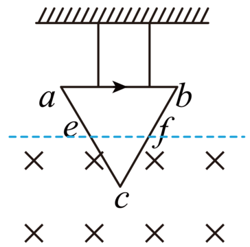

# Physics - 题目 1247

**ID**: 845fe3a1b6e64697981819731da413be
**年级**: Grade 12
**难度**: Medium
**题型**: Multiple-choice

## 题目
如图所示，边长为l的正三角形线框abc用两根绝缘细线对称悬挂，静止时ab直线水平，线框中通有沿顺时针方向的电流，图中水平虚线通过ac边和bc边的中点e、f，在虚线的下方有匀强磁场，匀强磁场的磁感应强度大小为B，方向垂直于导线框向里，此时每根细线的拉力大小为 $F{{}_{1}}$ 现保持其他条件不变，将虚线下方的磁场移至虚线上方，使虚线为匀强磁场的下边界，此时每根细线的拉力大小为 $F{{}_{2}}$ 则导线框中的电流大小为（      ）​​​​​​​‌

## 解答

1. 设三角形线框的质量为m，当磁场在虚线下方时，如图所示
2. 
3. 线框各边受到斜向下的安培力，大小各为
4. $F=\frac {1}{2}BIl$
5. 依据左手定则，可知，安培力夹角为 $60{}^\circ $ ，因此安培力合力为 $F{{}_{安}}$ ，即
6. $F{{}_{安}}=\frac {1}{2}BIL$
7. 由平衡条件知
8. $2F{{}_{1}}=mg+F{{}_{安}}$
9. 当把磁场移到虚线上方时, 线框各边受到安培力，如图所示
10. 
11. ac和bc两边受到的安培力大小各为
12. $F^{′}=\frac {1}{2}BIl$
13. 其夹角为 $60{}^\circ $ ，ab边受到安培力大小为
14. $F^{′′}=BIl$
15. 由矢量合成法则以及三角知识，则线框受到的安培力的合力，方向竖直向上，大小为
16. $F{{}_{安}^{\prime }}=\frac {1}{2}BIl$
17. 在竖直方向由平衡条件知
18. $2F{{}_{2}}+F{{}_{安}^{\prime }}=mg$
19. 两式相减可得
20. $I=\frac {2(F{{}_{1}}-F{{}_{2}})}{Bl}$
21. 故A正确，BCD错误。
22. 故选A。

## 知识点

**中文**:
  - 线框模型

**English**:
  - Wire Frame Model

---
