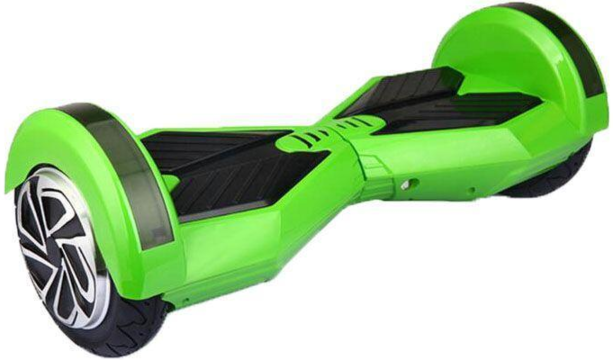

# Physics - 题目 1027

**ID**: 87e5afeb136d43e39eefdfc8a588fe5d
**年级**: Grade 12
**难度**: Medium
**题型**: Multiple-choice

## 题目
两轮平衡车（如图所示）广受年轻人的喜爱，它的动力系统由电池驱动，能够输出的最大功率为P_{0}，小明驾驶平衡车在水平路面上沿直线运动，受到的阻力恒为f，已知小明和平衡车的总质量为m，从启动到达到最大速度的整个过程中，小明和平衡车可视为质点，不考虑小明对平衡车做功，设平衡车启动后的一段时间内是由静止开始做加速度为a的匀加速直线运动，则下列说不正确的是（      ）​​​​​​​‌

## 解答

1. 根据牛顿第二定律可知 $F-f=ma$ ，解得 $F=f+ma$ ，根据 $P=Fv=(ma+f)v{\rm ，B}$ 错误A正确；平衡车匀加速直线运动速度达到最大值，有最大功率 $P{{}_{0}}=Fv$ ，联立可得 $v=\frac {P{{}_{0}}}{(f+ma)}$ ，启动后从静止到最大速度，平衡车做匀加速直线运动，所用时间为 $t=\frac {v}{a}=\frac {P{{}_{0}}}{(f+ma)a}{\rm ，C}$ 正确；平衡车所能达到的最大速度应该是合力为零时，即 $F=f$ ，可知最大速度为 $v{{}_{m}}=\frac {P{{}_{0}}}{f}{\rm ，D}$ 正确。

## 知识点

**中文**:
  - 机车启动的两种方式

**English**:
  - Two Modes of Locomotive Start-up

---
