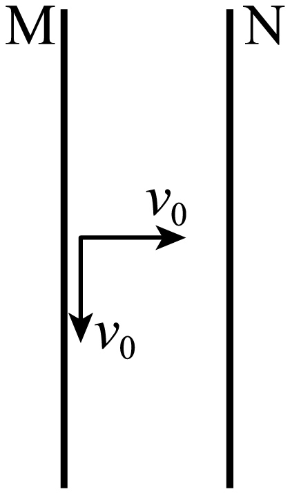

# Physics - 题目 2803

**ID**: 882308e6a2b547afbdb800ea3cbe69f6
**年级**: Grade 12
**难度**: Medium
**题型**: Multiple-choice

## 题目
如图所示，带等量异种电荷的两正对平行金属板M、N间存在匀强电场，板长为L（不考虑边界效应）。​​​​​​​‌t=0时刻，M板中点处的粒子源发射两个速度大小为v_{0}的相同粒子，垂直M板向右的粒子，到达N板时速度大小为 $\sqrt {2}v{{}_{0}}$ ；平行M板向下的粒子，刚好从N板下端射出。不计重力和粒子间的相互作用，则（      ）

## 解答

1. 由于不知道两粒子的电性，不能确定M板和N板的电势高低，A错误；根据题意垂直M板向右的粒子，到达N板时速度增加，动能增加，则电场力做正功，电势能减小；则平行M板向下的粒子到达N板时电场力也做正功，电势能同样减小，B错误；设两板间距离为d，对于平行M板向下的粒子刚好从N板下端射出，在两板间做类平抛运动，有 $\frac {L}{2}=v{{}_{0}}t$ ， $d=\frac {1}{2}at{^{2}}$ ，对于垂直M板向右的粒子，在板间做匀加速直线运动，因两粒子相同，在电场中加速度相同，有 ${\left({\sqrt {2}v{{}_{0}}}\right)^{2}}-v{{}_{0}^{2}}=2ad$ ，联立解得 $t=\frac {L}{2v{{}_{0}}}$ ， $a=\frac {2v{{}_{0}^{2}}}{L}{\rm ，C}$ 正确，D错误。

## 知识点

**中文**:
  - 带电粒子在匀强电场中的运动

**English**:
  - Motion in Uniform Electric Field

---
