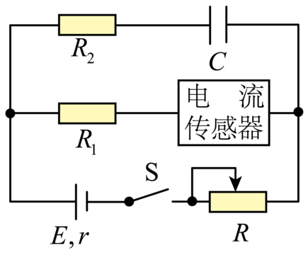

# Physics - 题目 2637

**ID**: 90805fc07e8047ab907a8cbe57672c06
**年级**: Grade 12
**难度**: Medium
**题型**: Multiple-choice

## 题目
如图所示，某同学用电流传感器探究电容器充电过程中对旁路的影响，t=0时刻闭合开关S，则能正确表示此后电阻R_{1}中电流变化过程的图像是（      ）​​​​​​​‌

## 解答

1. 闭合开关S瞬间，对电容器充电，通过R_{2}的电流逐渐减小，则通过R_{1}的电流逐渐增加，电容器充电结束，通过R_{1}的电流达到最大，并保持不变。选B。

## 知识点

**中文**:
  - 电容器的充放电过程及其动态分析

**English**:
  - Capacitor Charge/Discharge and Dynamic Analysis

---
