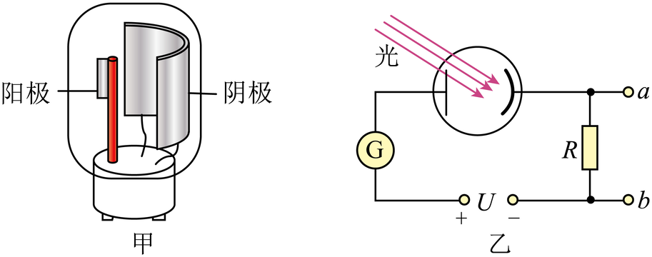

# Physics - 题目 1660

**ID**: 9be037dcbc8848a9960e269b543c9574
**年级**: Grade 12
**难度**: Medium
**题型**: Multiple-choice

## 题目
如图所示为光电管的结构及其工作原理图，当入射光照在管中金属板上时，电路中可以形成光电流。​​​​​​​‌在某次光电效应实验中，用波长为 ${\rm{λ}}{{}_{1}}$ 和 ${\rm{λ}}{{}_{2}}$ 的光分别照射同一光电管，均发生了光电效应，对应的逸出功分别为 $W{{}_{1}}$ 和 $W{{}_{2}}$ ，所逸出的光电子的最大初动能分别为 $E{{}_{{\rm{k}}1}}$ 、 $E{{}_{{\rm{k}}2}}$ ，遏止电压分别为 $U{{}_{{\rm{c}}1}}$ 、 $U{{}_{{\rm{c}}2}}$ ，且 $U{{}_{{\rm{c}}1}}>U{{}_{{\rm{c}}2}}$ ，则下列说法正确的是（      ）

## 解答

1. 同一光电管的逸出功 $W{{}_{0}}$ 相同，AB错误；根据 $E{{}_{{\rm{k}}{\rm{m}}}}=eU{{}_{{\rm{c}}}}$ ， $U{{}_{{\rm{c}}1}}>U{{}_{{\rm{c}}2}}$ ，可知 $E{{}_{{\rm{k}}{{1}}}}>E{{}_{{\rm{k}}{{2}}}}{\rm ，C}$ 错误；根据爱因斯坦光电效应方程 $E{{}_{{\rm{k}}{\rm{m}}}}=h{\rm{ν}}-W{{}_{0}}=h\frac {c}{{\rm{λ}}}-W{{}_{0}}$ ，由于最大初动能 $E{{}_{{\rm{k}}1}}>E{{}_{{\rm{k}}2}}$ ，则有 ${\rm{λ}}{{}_{1}}<{\rm{λ}}{{}_{2}}{\rm ，D}$ 正确。

## 知识点

**中文**:
  - 光电效应规律的综合应用

**English**:
  - Comprehensive Application of Photoelectric Effect

---
