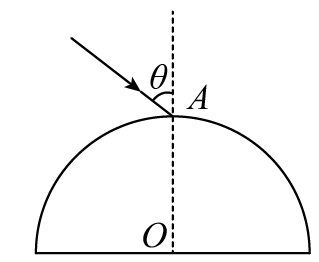

# Physics - 题目 35

**ID**: abd913feb0ac4054a741470b280adcfe
**年级**: Grade 12
**难度**: Medium
**题型**: Multiple-choice

## 题目
如图所示，由紫光与红光混合的细光束从底面镀银的半圆形玻璃砖顶点A以入射角 $θ{\rm =60°}$ 射入玻璃砖，已知该玻璃砖对紫光与红光的折射率分别为n_{1}、n_{2}（n_{1}>n_{2}> $\frac {\sqrt {6}}{2}$ ），光束在玻璃砖半圆弧面上发生折射时不考虑反射，紫光与红光在玻璃砖内传播的时间分别为t_{1}、t_{2}。​​​​​​​‌下列判断正确的是（      ）

## 解答

1. 作出光束在玻璃砖内传播的光路图。
2. 
3. 设半圆形玻璃砖的半径为R，真空中的光速为c，紫光、红光在A点的折射角分别为α、β。对紫光有
4. $n{{}_{1}}=\frac {\sin θ}{\sin α}$ ， $v{{}_{1}}=\frac {c}{n{{}_{1}}}$ ， $t{{}_{1}}=\frac {2R{\cos}α}{v{{}_{1}}}$
5. 解得
6. $t{{}_{1}}=\frac {2R\sin θ{\cot}α}{c}$
7. 同理得
8. $t{{}_{2}}=\frac {2R\sin θ{\cot}β}{c}$
9. 由于 $α<β$ ，故 $t{{}_{1}}>t{{}_{2}}$ ，选项A正确BCD错误。
10. 故选A。

## 知识点

**中文**:
  - 全反射与折射的综合应用

**English**:
  - Comprehensive Application of Total Reflection and Refraction

---
