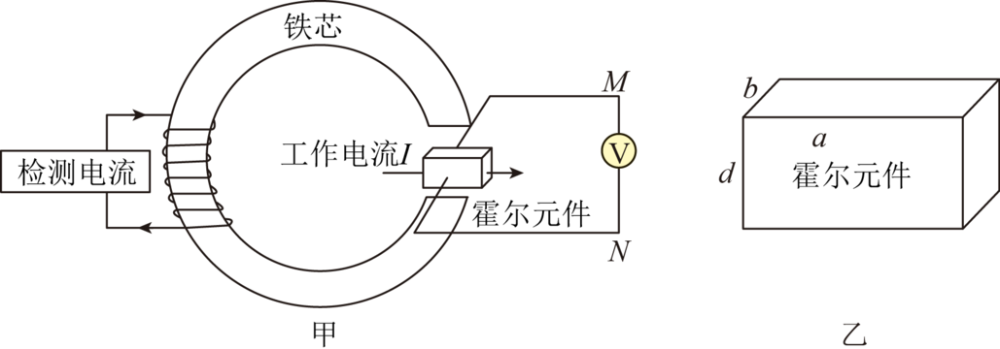

# Physics - 题目 1760

**ID**: abea81e0024c46efb059385705439c7b
**年级**: Grade 12
**难度**: Medium
**题型**: Multiple-choice

## 题目
如图甲所示是检测电流大小是否发生变化的装置。​​​​​​​‌该检测电流 （方向如图甲）在霍尔元件中产生磁场，其磁感应强度与检测电流成正比，其中的霍尔元件由金属制成，放大后如图乙所示，长、宽、高分别为 $a$ 、 $b$ 、 $d$  ；现给霍尔元件通一恒定工作电流 $I$  ，则（      ）

## 解答

1. A．根据安培定则可知，检测电流在霍尔元件处产生的磁场向上，金属的自由电荷为负电子，根据左手定则可知电子受到的洛伦兹力垂直纸面向外，故霍尔元件外表面带负电，故M端应与电压表的正接线柱相连，故A错误；C．如果仅将检测电流反向，电子受到的洛伦兹力反向，则电压表的正、负接线柱连线位置需要改动，故C错误；BD．稳定时，电子受到的洛伦兹力与电场力平衡，则有 $qvB=q\frac {U}{b}$ ，可得电压表示数为 $U=Bbv=Bb\frac {I}{nebd}=\frac {BI}{ned}$ ，可知在相同的检测电流下，要增大电压表读数可适当减小霍尔元件高度 $d$ ；当霍尔元件的材料与尺寸一定时，电压表示数变小，说明检测电流变小，故B正确，D错误。故选B。

## 知识点

**中文**:
  - 霍尔元件

**English**:
  - Hall Element

---
