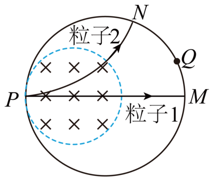

# Physics - 题目 1529

**ID**: afc24afb0ff6402a9b82413861722a1f
**年级**: Grade 12
**难度**: Medium
**题型**: Multiple-choice

## 题目
粒子物理研究中使用的一种球状探测装置横截面的简化模型如图所示。​​​​​​​‌内圆区域有垂直纸面向里的匀强磁场，外圆是探测器。两个粒子先后从 $P$ 点沿径向射入磁场，粒子1沿直线通过磁场区域后打在探测器上的 $M$ 点。粒子2经磁场偏转后打在探测器上的 $N$ 点。装置内部为真空状态，忽略粒子重力及粒子间相互作用力。下列说法正确的是（      ）

## 解答

1. AB．根据题意，由图可知，粒子1在磁场中不偏转，粒子1不带电，粒子2在磁场中受向上的洛伦兹力，由左手定则可知，粒子2带正电，AB错误；
2. C．由以上分析可知粒子1不带电，则无论如何增大磁感应强度，粒子1都不会偏转，C错误；
3. D．粒子2在磁场中洛伦兹力提供向心力，有
4. $qvB=m\frac {v{^{2}}}{r}$
5. 可得
6. $r=\frac {mv}{qB}$
7. 可知，若增大粒子入射速度，粒子2偏转半径变大，则粒子2可能打在探测器上的 $Q$ 点，D正确。
8. 选D。

## 知识点

**中文**:
  - 带电粒子在有界匀强磁场中的运动

**English**:
  - Motion in Bounded Uniform Magnetic Field

---
