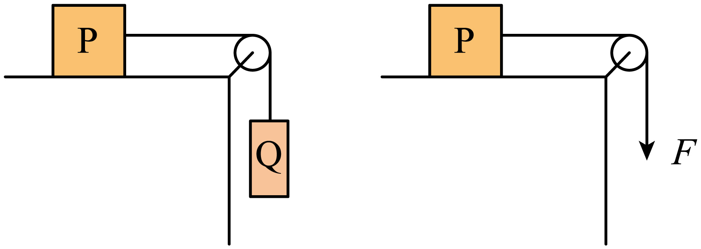

# Physics - 题目 2743

**ID**: b33f8fab123a47b1bf990904406756e4
**年级**: Grade 12
**难度**: Medium
**题型**: Multiple-choice

## 题目
如图所示，物体P置于光滑的水平面上，用轻细线跨过质量不计的光滑定滑轮连接一个重力G＝15N的重物Q，物体P向右运动的加速度为a_{1}；​​​​​​​‌若细线下端不挂重物，而用F＝15N的力竖直向下拉细线下端，这时物体P的加速度为a_{2}，则下列说法正确的是（      ）

## 解答

1. 挂重物时，选P和Q为研究对象，根据牛顿第二定律，有 $G=\left ({m{{}_{P}}+m{{}_{Q}}}\right )a{{}_{1}}$ ，可得共同运动的加速度大小为 $a{{}_{1}}=\frac {G}{m{{}_{{\rm{P}}}}+m{{}_{{\rm{Q}}}}}=\frac {15}{m{{}_{{\rm{P}}}}+m{{}_{{\rm{Q}}}}}$ ，当改为F＝15N拉力后，由牛顿第二定律，有 $F=m{{}_{P}}a{{}_{2}}$ ，可得P的加速度为 $a{{}_{2}}=\frac {F}{m{{}_{{\rm{P}}}}}=\frac {15}{m{{}_{{\rm{P}}}}}$ ，由此可知 $a{{}_{1}}<a{{}_{2}}$ 。

## 知识点

**中文**:
  - 连接体问题（整体和隔离法）、临界问题

**English**:
  - Connected Bodies Problems (Whole/Isolation Method), Critical Problems

---
