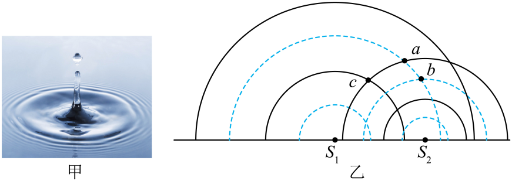

# Physics - 题目 820

**ID**: b5a6e56e9d6d43809b61640ad1703d29
**年级**: Grade 12
**难度**: Medium
**题型**: Multiple-choice

## 题目
如图甲所示，水滴滴在平静的水面上，会形成水波向四周传播（可视为简谐波）。​​​​​​​‌可利用两个能够等间隔滴水的装置 ${\rm{S}}{{}_{1}}$ 、 ${\rm{S}}{{}_{2}}$ 来研究波的叠加现象，图乙所示为以 $S{{}_{1}}$ 、 $S{{}_{2}}$ 为波源的两水波在某时刻叠加的简化示意图，已知 $S{{}_{1}}$ 、 $S{{}_{2}}$ 的振幅均为A，该时刻它们形成的波峰和波谷分别由实线和虚线表示。则下列说法正确的是（      ）

## 解答

1. A．由题图可知，a处的质点此时刻处于两列波的波峰与波谷相遇的点，由波的叠加知识可知，此时刻a处速度为零。在同一介质中，不同的机械波的波速相等，根据 $v=λf$ ，由图知波源 $S{{}_{2}}$ 的波长小，所以波源 $S{{}_{2}}$ 的频率较大，即两列波的频率不同，两列波无法发生稳定的干涉现象，所以a处的质点并不是一直处于静止状态，即a处质点的振幅不为零，A项错误；
2. B．由题图可知，b处的质点此时刻处于两列波的波谷与波谷相遇的点，由波的叠加知识可知，此时刻该处质点的位移大小为2A，B项正确；
3. C．在同一介质中，不同的机械波的波速相等，根据 $v=λf$ ，由图知波源 $S{{}_{2}}$ 的波长小，所以波源 $S{{}_{2}}$ 的频率较大，为观察到稳定的干涉图样，可将途中 $S{{}_{2}}$ 的频率调小，即将 ${\rm{S}}{{}_{2}}$ 滴水间隔调大，C项错误；
4. D．将两装置的滴水间隔调至相等，此时两列波的频率相同，会产生稳定的干涉现象，但是c出的质点其不一定处于振动加强点，即c处的质点不一定做振幅为2A的简谐运动，D项错误。选B。

## 知识点

**中文**:
  - 波的干涉的应用

**English**:
  - Applications of Wave Interference

---
