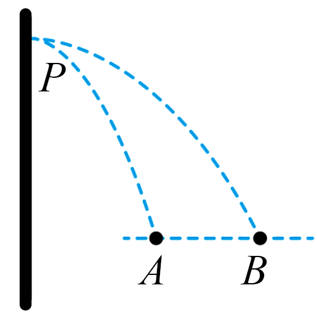

# Physics - 题目 2999

**ID**: b8452e4bc08348f2bcda522f4abe9ccb
**年级**: Grade 12
**难度**: Medium
**题型**: Multiple-choice

## 题目
篮球是中学生喜欢的运动，如图所示，小明在某次训练投球时从同一高度的A、B两点先后将篮球抛出，篮球恰好都能垂直打在篮板上的P点，不计空气阻力，上述两个过程中（      ）​​​​​​​‌

## 解答

1. 将篮球看成反向平抛运动，篮球在竖直方向下降的高度相同，在竖直方向有 $h=\frac {1}{2}gt{^{2}}$ ，可知篮球从两点下落的时间相同；在水平方向，可知 $x{{}_{A}}<x{{}_{B}}$ ，根据 $x=v{{}_{0}}t$ ，可知 $v{{}_{0A}}<v{{}_{0B}}$ ，击中P点时速度即水平方向的速度，篮球从B点抛出击中P点时速度大，A正确；根据 $g=\frac {Δv}{Δt}$ ，可知篮球从两点抛出到击中P点，速度变化率相同，都为重力加速度，B错误；将篮球看成反向平抛运动，篮球在竖直方向下降的高度相同，在竖直方向有 $v{{}_{y}^{2}}=2gh$ ，说明从两点抛出的竖直方向速度相同，但在水平方向有 $v{{}_{0A}}<v{{}_{0B}}$ ，根据 $v=\sqrt {v{{}_{0}^{2}}+v{{}_{y}^{2}}}$ ，从B点抛出的速度更大，根据动能定理有 $W=\frac {1}{2}mv{^{2}}$ ，篮球从B点抛出时小明对球做的功更大，C错误；根据 $P=mgv{{}_{y}}$ ，可知从两点抛出的竖直速度相同，篮球从B点抛出时重力的瞬时功率相等，D错误。

## 知识点

**中文**:
  - 应用动能定理求解变力做功问题

**English**:
  - Solving Work Done by Variable Force

---
