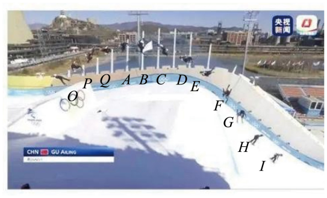

# Physics - 题目 2071

**ID**: b94dc898d8584bcc96d65cba44db9de5
**年级**: Grade 12
**难度**: Medium
**题型**: Multiple-choice

## 题目
北京冬奥会单板滑雪男子大跳台决赛中，苏翊鸣获得冠军，实现了中国单板滑雪在冬奥会上金牌零的突破。​​​​​​​‌图为苏翊鸣第二跳的频闪照片，曲线为运动轨迹，飞行过程中最高点A离地 $8.49{\rm{m}}$ （运动员的重心位置序号用图中字母表示），H点为运动员落地点，飞行过程不计空气阻力。已知：频闪频率为 $5{\rm{H}}{\rm{z}}$ ，曲线在O点的切线与水平方向成 $37{}\degree $ ， $g=10{{\rm{m}}}/{{\rm{s}}{^{2}}}$ ．下列说法正确的是（

## 解答

1. A．运动员在空中运动过程中只受重力，加速度为重力加速度g；在H点落地后的加速度不再是重力加速度g；所以运动员第二跳的全过程中不是匀变速运动，故A错误；
2. B．由运动员在O点的速度方向，可知其在O点时的水平分速度与竖直分速度满足 ${\tan}37{}\degree =\frac {v{{}_{yO}}}{v{{}_{x}}}$ ，
3. 频闪照相机的频率为5Hz，可知其任意两相邻位置之间的时间均为 $T=\frac {1}{5}{\rm{s}}=0.2{\rm{s}}$ ，
4. 由题意可知A点为空中离地最高点，则有 $v{{}_{yO}}=g\cdot 3T$ ，
5. 其在E点的水平分速度、竖直分速度满足 ${\tan}θ=\frac {v{{}_{yE}}}{v{{}_{x}}}$ ，
6. 其中 $v{{}_{yE}}=g\cdot 4T$ ，
7. 联立解得 ${\tan}θ=1$ ，
8. 则曲线在E点的切线与水平方向成 $45{}\degree $ ，故B正确；
9. C．对运动员落地时受力分析，即可知其在垂直于地面方向的速度会减为零，从H到I的过程，沿斜面方向加速，无法确定减小的分速度与增大的分速度哪个大，所以运动员在I点的速度大小不一定大于G点的速度大小，故C错误；
10. D．运动员落地时，受到接触面的弹力方向垂直接触面，受到接触面的摩擦力方向沿接触面，则受到接触面作用力方向与接触面不垂直，故D错误。
11. 故选B。

## 知识点

**中文**:
  - 斜抛运动

**English**:
  - Oblique Projectile Motion

---
