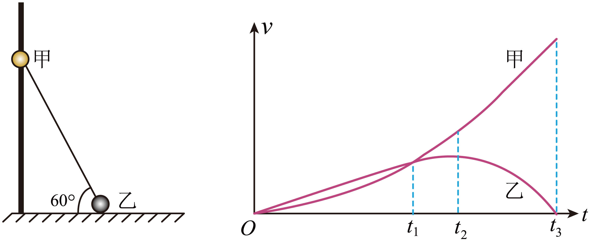

# Physics - 题目 993

**ID**: b95c5259f5f941b2bce7ce0049c40e76
**年级**: Grade 12
**难度**: Medium
**题型**: Multiple-choice

## 题目
可视为质点的甲、乙两小球用铰链与轻杆连接，甲球套在固定的竖直杆上，乙球处于水平地面上，初始时轻杆与水平方向夹角为60°，杆长为L。​​​​​​​‌无初速度释放两球到甲球落地的过程中，两球的速率随时间变化如图所示，其中 $t{{}_{2}}$ 时刻乙球速率最大。已知甲球质量为2m，乙球质量为m，重力加速度大小为g，不计一切摩擦，则（      ）

## 解答

1. 设轻杆与水平方向的夹角为θ，甲、乙两球的速度大小分别为 $v{{}_{1}}$ 和 $v{{}_{2}}$ ，将 $v{{}_{1}}$ 和 $v{{}_{2}}$ 分别沿杆和垂直杆方向分解，则有 $v{{}_{1}}\sin θ=v{{}_{2}}{\cos}θ$ ，由图可知 $t{{}_{1}}$ 时刻有 $v{{}_{1}}=v{{}_{2}}$ ，解得 $θ=45{}\degree {\rm ，A}$ 错误；由受力分析可得，杆对乙球的作用先是推力，后是拉力， $t{{}_{2}}$ 时刻乙球速率最大，即此时杆恰好对乙球无作用力，则此时杆对甲也无作用力，甲只受到竖直方向的重力作用，此时甲球的加速度等于g，B错误； $t{{}_{3}}$ 时刻乙球速度为0，则此时甲球落地，从无初速度释放两球到甲球落地的过程中，两球组成的系统只有重力做功，系统机械能守恒，则有 $2mgL\sin 60{}\degree =\frac {1}{2}\times 2mv{{}_{1}^{2}}$ ，解得 $t{{}_{3}}$ 时刻甲球的速率 $v{{}_{1}}=\sqrt {\sqrt {3}gL}{\rm ，C}$ 错误； $0\sim t{{}_{3}}$ 过程甲、乙两球的速率图线与时间轴所围成的面积即为该过程中甲、乙两球的位移，甲球的位移 $x{{}_{1}}=L\sin 60{}\degree =\frac {\sqrt {3}}{2}L$ ，乙球的位移 $x{{}_{2}}=L-L{\cos}60{}\degree =\frac {L}{2}$ ，面积之比为 $x{{}_{1}}:x{{}_{2}}=\sqrt {3}:1{\rm ，D}$ 正确。

## 知识点

**中文**:
  - 球杆模型圆周运动中机械能守恒定律的应用

**English**:
  - Rod-Ball Circular Motion Models

---
