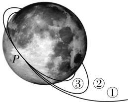

# Physics - 题目 1454

**ID**: b97ebd5b472a4c5db388b492e5c6cca5
**年级**: Grade 12
**难度**: Medium
**题型**: Multiple-choice

## 题目
【变轨问题】如图所示为嫦娥六号探测器“奔月”过程，其历经了①地月转移、②近月制动、③环月飞行（可视为在月球表面飞行）等过程，已知三个过程的轨道均经过 $P$ 点。​​​​​​​‌则（      ）

## 解答

1. ③可视为在月球表面飞行，设其周期为 $T$ ，根据万有引力提供向心力有 $G\frac{Mm}{{R}^{2}}=m{\left(\frac{2\mathrm{\pi }}{T}\right)^{2}}R$ ，解得 $M=\frac{4{\mathrm{\pi }}^{2}{R}^{3}}{G{T}^{2}}$ ，则月球的密度为 $\rho =\frac{M}{\frac{4}{3}\mathrm{\pi }{R}^{3}}$ ，解得 $\rho =\frac{3\mathrm{\pi }}{G{T}^{2}}$ ，所以通过测量③上的运行周期可以估测月球密度， $\mathrm{A}$正确；嫦娥六号从低轨道到高轨道需要加速，故②转移到①时需要加速， $\mathrm{B}$错误；根据牛顿第二定律有 $G\frac{Mm}{{r}^{2}}=ma$ ，解得 $a=\frac{GM}{{r}^{2}}$ ，可知②上经过 $P$ 点时加速度与③上经过 $P$ 点时加速度相等， $\mathrm{C}$错误；根据开普勒第三定律，可知轨道半长轴越大，周期越大， $\mathrm{D}$错误。

## 知识点

**中文**:
  - 万有引力定律问题的分析与计算

**English**:
  - Analysis and Calculation of Gravitation Problems

---
