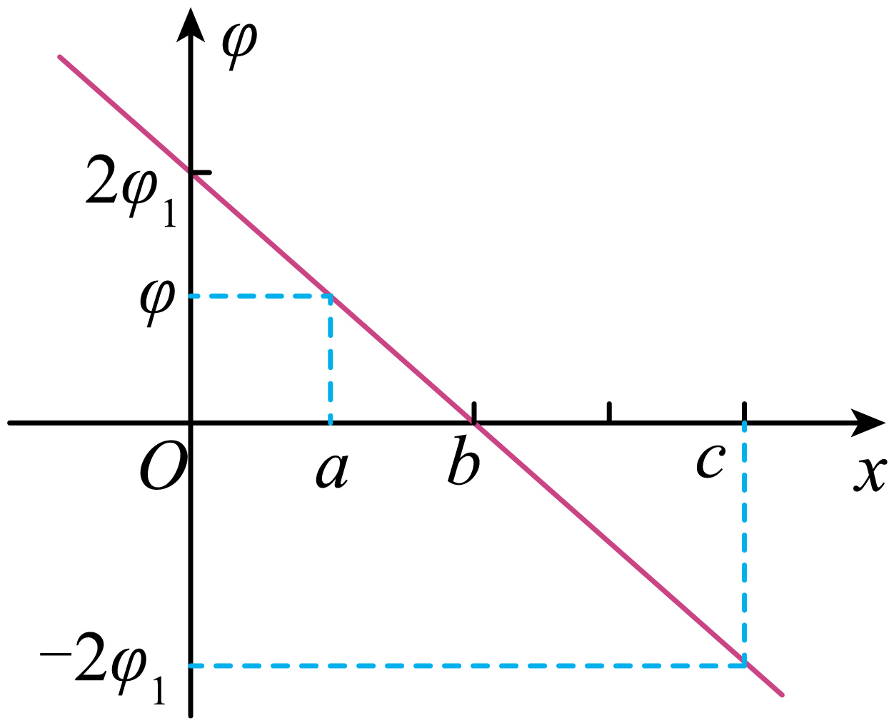

# Physics - 题目 807

**ID**: baa49382c78343f197abe401b1b13cff
**年级**: Grade 12
**难度**: Medium
**题型**: Multiple-choice

## 题目
空间中存在方向平行于x轴的电场，其电势 $φ$ 随x的变化关系如图所示。​​​​​​​‌一带电粒子沿x轴正方向、以速度大小 $v{{}_{0}}$ 由O点射出，粒子运动到c点时的速度恰好为0，已知粒子仅受静电力作用。下列说法正确的是（      ）

## 解答

1. $φ-x$ 图像斜率的绝对值为电场强度的大小，由题图可知电场强度大小恒定，沿电场强度方向电势降低，电场强度沿 $x$ 轴正方向，A错误；电场强度沿 $x$ 轴正方向，带电粒子从O点开始做匀减速运动至c点，由此可知带电粒子所受电场力沿 $x$ 轴负方向，所以粒子带负电，负电荷所处位置的电势越小，其电势能就越大，粒子从从a点到b点，电势减小，电势能增加，B正确；从O到c，由动能定理有 $-4φ{{}_{1}}q=0-\frac {1}{2}mv{{}_{0}^{2}}$ ，从O到b，由动能定理 $-2φ{{}_{1}}q=\frac {1}{2}mv{{}_{b}^{2}}-\frac {1}{2}mv{{}_{0}^{2}}$ ，联立解得 $v{{}_{b}}=\frac {\sqrt {2}}{2}v{{}_{0}}{\rm ，C}$ 错误；粒子从O点开始做匀减速运动至c点，然后由c点沿x轴负方向做匀加速直线运动，到O点时速度不为0，不会在O、c两点间一直做往返运动，D错误。

## 知识点

**中文**:
  - 静电场中的图像问题

**English**:
  - Graph Problems in Electrostatic Fields

---
