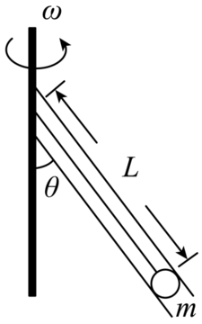

# Physics - 题目 261

**ID**: c1459e7eedec4c3787f409556cd2f783
**年级**: Grade 12
**难度**: Medium
**题型**: Multiple-choice

## 题目
如图，内壁光滑的玻璃管内用长为L的轻绳悬挂一个小球。​​​​​​​‌当玻璃管绕竖直轴以角速度 $ω$ 匀速转动时，小球与玻璃管间恰无压力。下列说法正确的是（      ）

## 解答

1. AB．当管壁对球无作用力时， 绳子的拉力和球的重力合力提供向心力， 所以
2. $a{{}_{向}}=g\cdot {\tan}θ=ω{^{2}}\cdot L\sin θ$
3. $ω=\sqrt {\frac {g}{L{\cos}θ}}$
4. 故，增加绳长之后，此时小球需要的向心力增大，重力与细绳的拉力不足以提供向心力，则小球将受到玻璃管斜向下方的压力；增加绳长之后，小球做圆周运动的半径增大，要保持小球与管壁之间无压力，则小球所需向心力大小不变，半径增大，则需要减小角速度ω， 故AB错误；
5. C．增加小球质量，此时
6. $mg{\tan}θ=mω{^{2}}L\sin θ$
7. 质量可被约去，小球做圆周运动的半径不变，小球对玻璃管无压力，故玻璃管对小球也无压力， 故C错误；
8. D．仅增加角速度至ω′后，小球需要的向心力增大，小球有离心的趋势，小球将垂直于右侧管壁挤压管壁，玻璃管会给小球一个斜向下的压力， 故D正确。
9. 故选D。

## 知识点

**中文**:
  - 水平面内匀速圆周问题

**English**:
  - Uniform Circular Motion in Horizontal Plane

---
