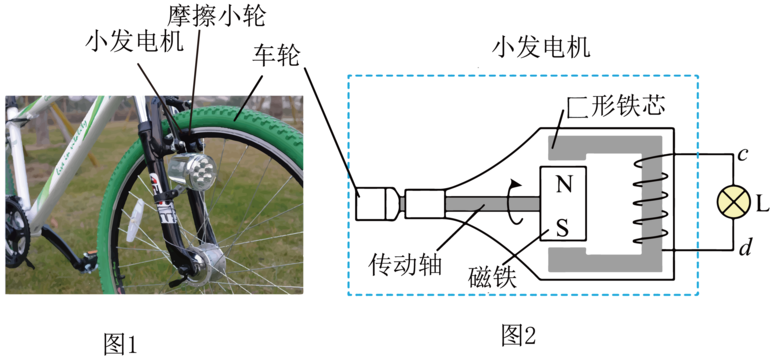
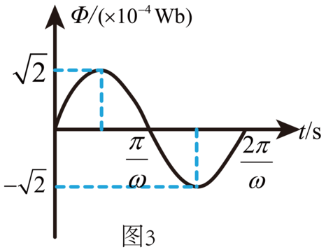

# Physics - 题目 86

**ID**: c1a21d6029fe481db5a5cb1ea1ad8c4b
**年级**: Grade 12
**难度**: Medium
**题型**: Multiple-choice

## 题目
某自行车的车灯发电机如图1所示，其结构如图2。​​​​​​​‌绕有300匝线圈的匚形铁芯开口处装有磁铁。车轮转动时带动半径为2cm的摩擦小轮转动，摩擦小轮又通过传动轴带动磁铁一起转动，从而使铁芯中磁通量发生变化，其变化图像如图3所示，其中 $ω$ 为摩擦小轮转动的角速度。线圈两端c、d作为发电机输出端与标有“12V，6W”的灯泡L相连。当自行车以速度v匀速行驶时，小灯泡恰好正常发光。假设灯泡阻值不变，线圈的总电阻为 $6Ω$ ，摩擦小轮与轮胎间不打滑，发电机输出电压可视为正弦交流电压。则（      ）

## 解答

1. 令感应电动势的最大值为 $E{{}_{{\rm \max }}}$ ，则有 $E{{}_{{\rm \max }}}=NBSω=NΦ{{}_{{\rm \max }}}ω$ ，则感应电动势的有效值 $E{{}_{0}}=\frac {E{{}_{{\rm \max }}}}{\sqrt {2}}$ ，小灯泡恰好正常发光，则有 $\frac {E{{}_{0}}}{R{{}_{线}}+R{{}_{灯}}}=\frac {U{{}_{灯}}}{R{{}_{灯}}}$ ，对小灯泡有 $P{{}_{灯}}={\left({\frac {U{{}_{灯}}}{R{{}_{灯}}}}\right)^{2}}R{{}_{灯}}$ ，解得 $ω=500{\rm{r}}{\rm{a}}{\rm{d}}{\rm{/}}{\rm{s}}{\rm ，B}$ 错误；车轮转动时带动半径为2cm的摩擦小轮转动，根据 $v=ωr$ ，结合上述解得 $v=10{\rm{m}}{\rm{/}}{\rm{s}}{\rm ，A}$ 正确；自行车的速度减半，结合上述可知，摩擦小轮转动的角速度减半，感应电动势的最大值减半，感应电动势的有效值减半，根据闭合电路欧姆定律可知，感应电流的有效值减半，则小灯泡的功率减为先前的 $\frac {1}{4}{\rm ，C}$ 错误；磁铁处于图2位置时，穿过线圈的磁通量达到最大值，根据图3可知，此时磁通量的变化率为0，即磁铁处于图2位置时，小灯泡两端的电压为0，D错误。

## 知识点

**中文**:
  - 理想变压器原、副线圈两端的电压、功率、电流关系及其应用

**English**:
  - Voltage, Power, Current Relations in Ideal Transformers

---
