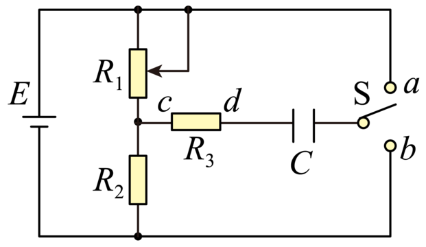

# Physics - 题目 1551

**ID**: cdc52bbedbe04883b81832f1bf9b4efc
**年级**: Grade 12
**难度**: Medium
**题型**: Multiple-choice

## 题目
如图所示，电源电动势 $E=1.5{\rm{V}}$ ，内阻不计，滑动变阻器 $R{{}_{1}}$ 的最大阻值为 $2Ω$ ，两定值电阻 $R{{}_{2}}$ 、 $R{{}_{3}}$ 的阻值均为 $1Ω$ ，电容器C的电容为 $3μ{\rm{F}}$ 。​​​​​​​‌初始时 $R{{}_{1}}$ 的滑片置于最上端，开关S掷于a端。下列说法正确的是（      ）

## 解答

1. A．开关 ${\rm S}$ 掷于 $a$ 端， $R{{}_{1}}$ 与 $R{{}_{2}}$ 串联， $R{{}_{2}}$ 两端的电压
2. $U{{}_{2}}=\frac {E}{R{{}_{1}}+R{{}_{2}}}·R{{}_{2}}$
3. 当 $R{{}_{1}}$ 的滑片向下滑动时， $R{{}_{1}}$ 接入电路中的电阻值变小， $R{{}_{2}}$ 两端电压变大，A错误；
4. B． $R{{}_{1}}$ 消耗的功率
5. $P=EI-I{^{2}}R{{}_{2}}$
6. 电流
7. $I=\frac {E}{R{{}_{1}}+R{{}_{2}}}$
8. 解得当 $R{{}_{1}}=R{{}_{2}}=1{\rm{Ω}}$ 时， $R{{}_{1}}$ 消耗的功率最大为 $0.5625{\rm{W}}{\rm ，B}$ 错误；
9. C．开关掷于 $a$ 端时，电容器 ${\rm C}$ 右极板带正电，开关从 $a$ 掷向 $b$ ，电容器 ${\rm C}$ 左极板带正电，所以电容器先放电后充电，电流方向为 $c\to d{\rm ，C}$ 错误；
10. D．流过 $R{{}_{3}}$ 的电荷量
11. $Q=C·ΔU=C\left ({\frac {E}{R{{}_{1}}+R{{}_{2}}}·R{{}_{2}}+\frac {E}{R{{}_{1}}+R{{}_{2}}}·R{{}_{1}}}\right )=4.5\times 10{^{-6}}{\rm{C}}$
12. D正确。
13. 故选D。

## 知识点

**中文**:
  - 电路的动态分析问题

**English**:
  - Dynamic Circuit Analysis

---
