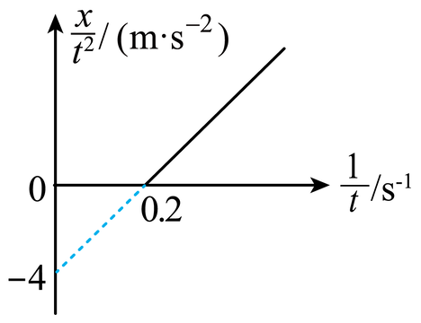

# Physics - 题目 1206

**ID**: d350d73abdea4510b6cd795b0782be7d
**年级**: Grade 12
**难度**: Medium
**题型**: Multiple-choice

## 题目
小智同学发现了一张自己以前为研究机动车的运动情况绘制的 $\frac {x}{t{^{2}}}-\frac {1}{t}$ 图像（如图）。​​​​​​​‌已知机动车运动轨迹是直线，但是不知机动车是处于加速还是刹车状态，请你帮他判定以下合理的说法是（      ）

## 解答

1. 根据位移时间关系 $x=v{{}_{0}}t+\frac {1}{2}at{^{2}}$ ，可得 $\frac {x}{t{^{2}}}=\frac {v{{}_{0}}}{t}+\frac {1}{2}a$ ，结合图像可得 $v{{}_{0}}=\frac {4}{0.2}{\rm{m}}{\rm{/}}{\rm{s}}=20{\rm{m}}{\rm{/}}{\rm{s}}$ ， $\frac {1}{2}a=-4$ ，所以 $a=-8{\rm{m}}{\rm{/}}{\rm{s}}{^{{{2}}}}$ ，故BC错误；由于初速度为正值，加速度为负值，二者方向相反，所以机动车做匀减速运动，故A错误；机动车停止运动的时间为 $t{{}_{0}}=\frac {0-v{{}_{0}}}{a}=\frac {0-20}{-8}{\rm{s}}=2.5{\rm{s}}$ ，根据位移时间关系可得，机动车在前3秒的位移为 $x{{}_{3}}=\frac {v{{}_{0}}}{2}t{{}_{0}}=\frac {20}{2}\times {{2}}{{.}}{{5}}{\rm{m}}=25{\rm{m}}$ ，故D正确。

## 知识点

**中文**:
  - 非常规图像问题

**English**:
  - Non-standard Graph Problems

---
