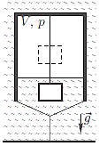

# Physics - 题目 1090

**ID**: d3b218d6e0544ed9b7c23b1ea3d1cd80
**年级**: Grade 12
**难度**: Medium
**题型**: Multiple-choice

## 题目
潜水罩形如无底圆柱，放在水下，里面有一部分空气。​​​​​​​‌为了使得罩不会浮起来，用缆绳绑在水底。用一根细绳将重物系在罩上，如图所示。罩的横截面积S=4m^{2}，里面空气的体积V=8m^{3}，压强p=1.5×10^{5}Pa。将罩里的重物拉出水面后，空气压强增加了Δp=250Pa，缆绳仍然处于拉伸状态。求细绳和缆绳中张力的变化量。水的密度ρ=10^{3}kg/m^{3}，重力加速度g=10m/s^{2}，罩里的空气符合波意耳定律pV=常数，其中p为压强，V为罩里空气的体积。（      ）

## 解答

1. A．分子平均动能由温度决定，是统计规律，而单个分子运动具有偶然性，故A错误；
2. B．由于气体体积减小，外界对气体做功，而气体的内能不变，由热力学第一定律可知，气体对外放热，故B错误；
3. CD．由玻意耳定律pV=常数，有
4. $1.5\times 10{^{5}}\times 8=(1.5\times 10{^{5}}+250)\times (8-V^{′})$
5. 缆绳中张力减小了
6. $ΔF=ρ{{}_{水}}gV^{′}=133{\rm{N}}$
7. 设潜水罩的质量为m_{0}，潜水罩上部受到的压强为 $p^{′}$ ，对潜水罩进行受力分析，刚开始有
8. $p^{′}+m{{}_{0}}g+T+F=pS$
9. 末状态
10. $p^{′}+m{{}_{0}}g+T^{′}+F^{′}=(p+Δp)S$
11. $ΔF=F-F^{′}=133{\rm{N}}$
12. 故可以计算得出
13. $ΔT=T^{′}-T=1133{\rm{N}}$
14. 即细绳中的张力增大了1133N，缆绳中的张力减小了133N，所以C错误，D正确。
15. 故选D。

## 知识点

**中文**:
  - 气体等温变化与玻意耳定律
  - 热力学第一定律与理想气体状态方程的综合应用

**English**:
  - Isothermal Change and Boyle's Law
  - Integrated Application of 1st Law and Ideal Gas Law

---
